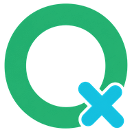
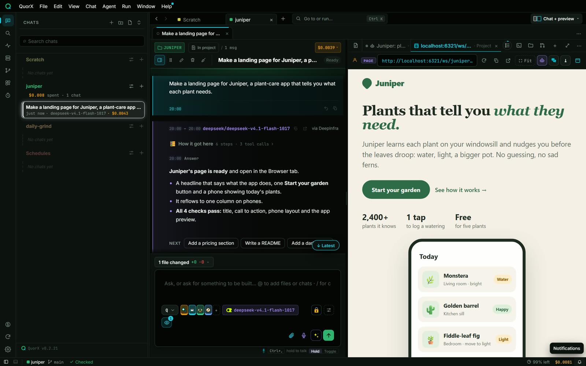
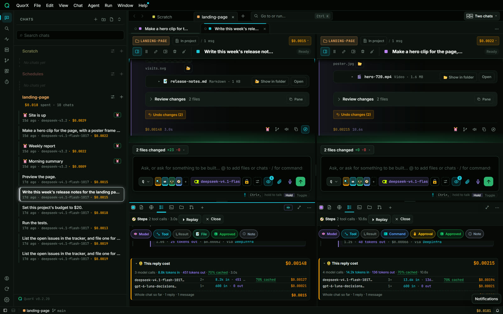
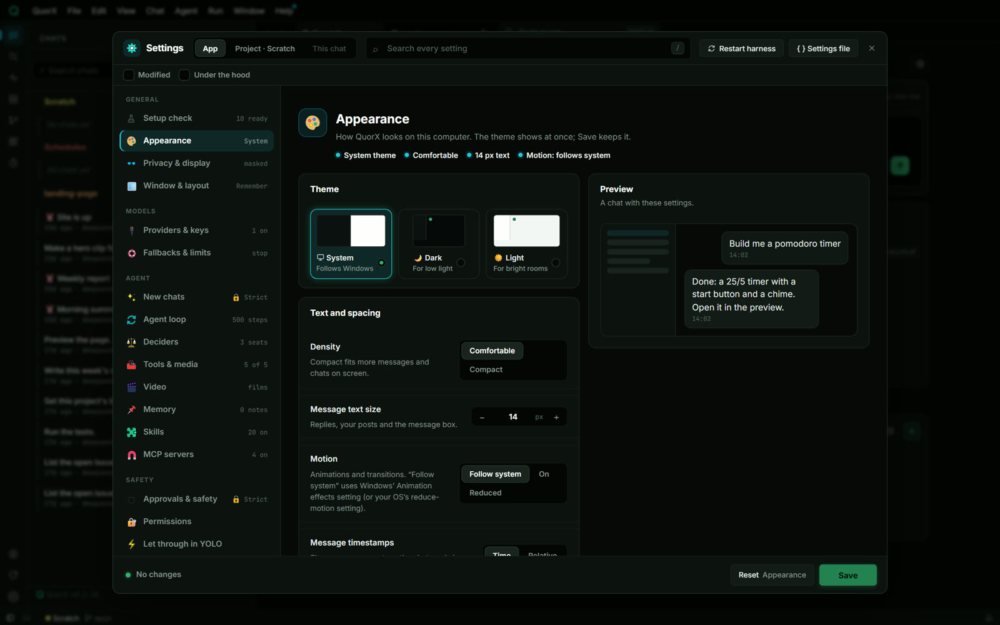

<p align="center">
  
</p>

<h1 align="center">QuorX</h1>

<p align="center">
  <b>An open-source AI agent that builds on your own computer, with a quorum of models checking its work.</b><br>
  Any model: OpenRouter, makers' APIs, subscriptions or this PC · Windows first · Apache 2.0
</p>



## What it is

You describe what you want: a game, a site, a desktop app, a fix. QuorX's agent works in a project folder you pick,
with a real terminal, a real browser and the tools already on your computer. It builds the thing, opens it, tests it
the way a person would, and shows you every step it took.

- **Any model, priced up front.** Every model on OpenRouter, plus makers' own APIs (OpenAI, Anthropic, Gemini, xAI,
  DeepSeek, Mistral and more), coding-plan subscriptions, the coding CLIs you've signed in to on this PC, and local
  models from LM Studio, Ollama, Foundry Local or llama.cpp. Each shows its price before you pick it.
- **A quorum behind it.** Small, fast "decider" models answer the agent's questions and check its work, which helps
  cheaper models build better.
- **Safe by default.** Risky commands wait for your OK, every change can be undone, and Stop ends everything.
- **It checks before it says done.** Each build is opened, clicked through and scored by a separate reviewer model.
- **A workspace laid out like an editor.** Projects as tabs, chats as tabs you can put side by side, one-click layouts,
  a bottom panel for terminals and servers, and in the desktop app any tab popped out into its own window.

| | |
|---|---|
|  |  |
| **Work on two chats at once**, with a layout for each way of working. | **Settings in one window**, every option with its own page. |

## Get it

**Windows:** get QuorX from the Microsoft Store. Microsoft signs it and keeps it up to date.

<a href="https://apps.microsoft.com/detail/9NBK5DMLMTFF?mode=direct"></a>

Or download the installer from the [latest release](https://github.com/mims1234/QuorX/releases/latest). It isn't
code-signed yet, so Windows may warn you; [here's how to check the download](docs/GETTING-STARTED.md#install-the-app-windows).

**From source** (Windows, macOS, Linux), with Node.js 20+:

```bash
npm install
npm start
```

Then open the link it prints (QuorX opens at http://quorx.localhost:5188) and sign in with OpenRouter, or add another
provider in ⚙ Settings → Providers & keys. The full setup is in [Getting started](docs/GETTING-STARTED.md).

**Official downloads** come only from the Microsoft Store, this repository's
[releases](https://github.com/mims1234/QuorX/releases) and [quorx.genxmims.org](https://quorx.genxmims.org).

## Learn more

| | |
|---|---|
| [What QuorX does](docs/FEATURES.md) | Every feature, with screenshots, and what it deliberately doesn't do |
| [Getting started](docs/GETTING-STARTED.md) | Installing, signing in, the desktop app, and where your data lives |
| [How it works](docs/REPORT.md) | The full report: the agent loop, the deciders, the safety layer, platform packs, research |
| [Research notes 0.2.7](docs/research/0.2.7-overview.md) | Agentic integrity, measured: checked work across models, a cheaper prompt, deciders and creativity, a post-mortem |
| [Testing](docs/TESTING.md) | Running the tests, and helping test platform packs |
| [Privacy](PRIVACY.md) | What stays on your computer and what leaves it |
| [Security](SECURITY.md) | Reporting a problem, checking downloads, and what the guards do and don't cover |
| [Contributing](CONTRIBUTING.md) | Setting up, running the tests, pull requests, and sending a pack test report |
| [Model cards](models/README.md) | Each recommended model's limits, quirks and prompting tips, and how the cards are kept up to date |
| [Releasing](docs/RELEASING.md) | How a version goes out: a pre-release first, then Promote release, and Pull release to take one back |
| [Launch trailer](https://youtu.be/-A36aZuz0m0) | The one-minute film from QuorX's first release (it shows the earlier look) |

## A friendly reminder

QuorX is powerful: its agent runs real commands on your own computer, which is what lets it build and test real
apps. That deserves a little care, the same as any powerful tool.

- **Start in 🔒 Strict** (the default). You see each command that needs your OK, and you'll quickly get a feel for
  what the agent does.
- **Keep your work in git or backed up.** QuorX can undo its own changes, but a second safety net never hurts.
- **Save ⚡ YOLO for projects you trust**, once you know how QuorX behaves. [Security](SECURITY.md) explains what its
  guards cover.

Like most open-source software, QuorX comes as is, without a warranty ([licence](LICENSE)).

## Licence

Open source under the [Apache License 2.0](LICENSE): use it, change it and fork it, for personal or commercial work,
as long as you keep the licence and the [NOTICE](NOTICE). The QuorX name and logo aren't covered by the licence, so a
fork should use its own; [Trademarks](TRADEMARKS.md) says what's welcome. Writing about QuorX or its research? GitHub's
**Cite this repository** button gives the citation.
