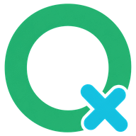
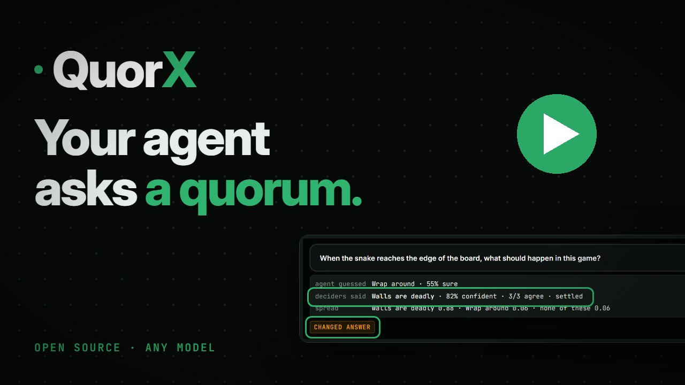
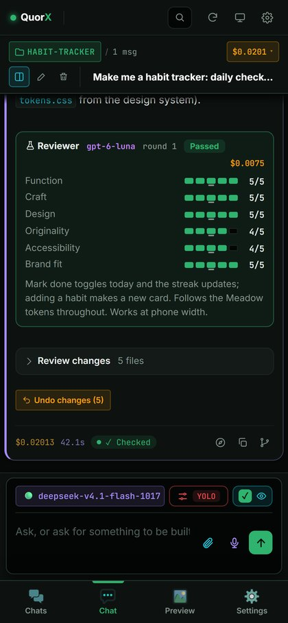

<p align="center">
  
</p>

<h1 align="center">QuorX</h1>

<p align="center">
  <b>An open-source AI agent that builds on your own computer, with a quorum of models checking its work.</b><br>
  Any model on OpenRouter · Windows first · Apache 2.0
</p>

<p align="center">
  <a href="https://youtu.be/-A36aZuz0m0"></a><br>
  <a href="https://youtu.be/-A36aZuz0m0">▶ Watch the trailer</a>
</p>

## What it is

You describe what you want: a game, a site, a desktop app, a fix. QuorX's agent works in a project folder you pick,
with a real terminal, a real browser and the tools already on your computer. It builds the thing, opens it, tests it
the way a person would, and shows you every step it took.


- **Any model, priced up front.** Pick from every model on OpenRouter, cheap or frontier, with its price shown.
- **A quorum behind it.** Small, fast "decider" models answer the agent's questions and check its work, which helps
  cheaper models build better.
- **Safe by default.** Risky commands wait for your OK, every change can be undone, and Stop ends everything.
- **It checks before it says done.** Each build is opened, clicked through and scored by a separate reviewer model.

## Get it

**Windows:** download the installer from the [latest release](https://github.com/mims1234/QuorX/releases/latest).
It isn't code-signed yet, so Windows may warn you; [here's how to check the download](docs/GETTING-STARTED.md#install-the-app-windows).

**From source** (Windows, macOS, Linux), with Node.js 20+:

```bash
npm install
npm start
```

Then open http://localhost:5188 and sign in with OpenRouter. The full setup is in [Getting started](docs/GETTING-STARTED.md).

## Learn more

| | |
|---|---|
| [What QuorX does](docs/FEATURES.md) | Every feature, with screenshots, and what it deliberately doesn't do |
| [Getting started](docs/GETTING-STARTED.md) | Installing, signing in, the desktop app, and where your data lives |
| [How it works](docs/REPORT.md) | The full report: the agent loop, the deciders, the safety layer, platform packs, research |
| [Testing](docs/TESTING.md) | Running the tests, and helping test platform packs |
| [Privacy](PRIVACY.md) | What stays on your computer and what leaves it |
| [Security](SECURITY.md) | Reporting a problem, checking downloads, and what the guards do and don't cover |
| [Contributing](CONTRIBUTING.md) | Setting up, running the tests, pull requests, and sending a pack test report |
| [Model cards](models/README.md) | Each recommended model's limits, quirks and prompting tips, and how the cards are kept up to date |
| [Releasing](docs/RELEASING.md) | How a version goes out: a pre-release first, then Promote release, and Pull release to take one back |

<p align="center">
  
  <br><sub>Leave the desktop app running and use QuorX from your phone.</sub>
</p>

## A friendly reminder

QuorX is powerful: its agent runs real commands on your own computer, which is what lets it build and test real
apps. That deserves a little care, the same as any powerful tool.

- **Start in 🔒 Strict** (the default). You see each command that needs your OK, and you'll quickly get a feel for
  what the agent does.
- **Keep your work in git or backed up.** QuorX can undo its own changes, but a second safety net never hurts.
- **Save ⚡ YOLO for projects you trust**, once you know how QuorX behaves. [Security](SECURITY.md) explains what its
  guards cover.

Like most open-source software, QuorX comes as is, without a warranty ([licence](LICENSE)).

## Licence

Open source under the [Apache License 2.0](LICENSE): use it, change it and fork it, for personal or commercial work,
as long as you keep the licence and the [NOTICE](NOTICE). The QuorX name and logo aren't covered by the licence, so a
fork should use its own.
