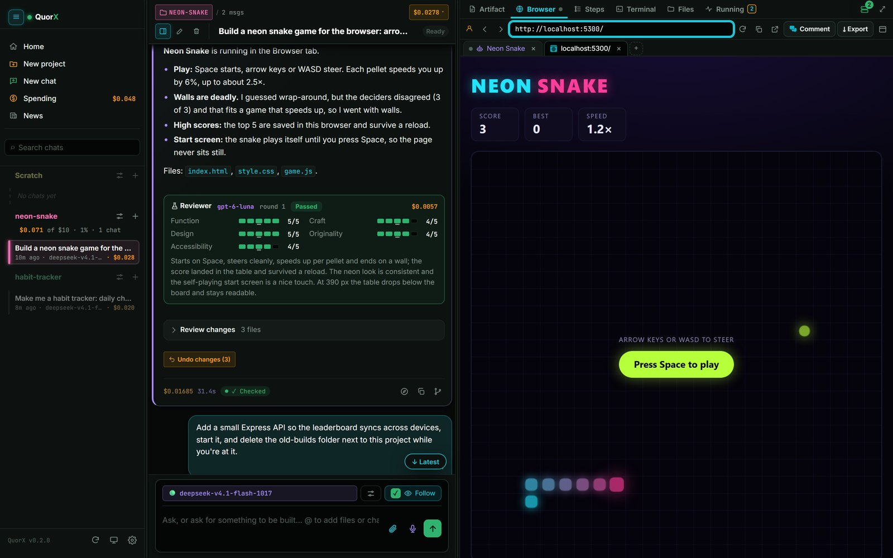
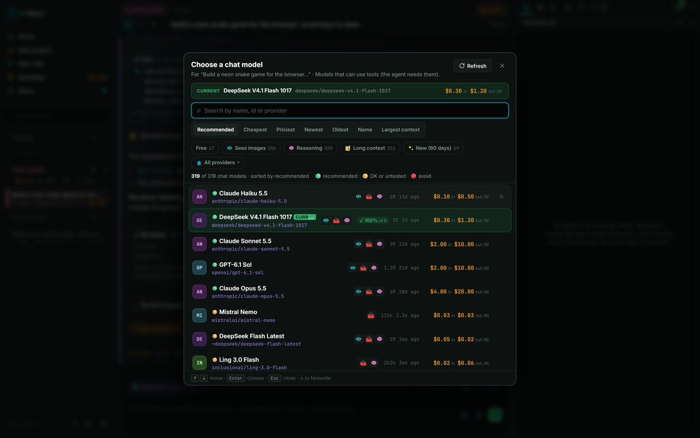
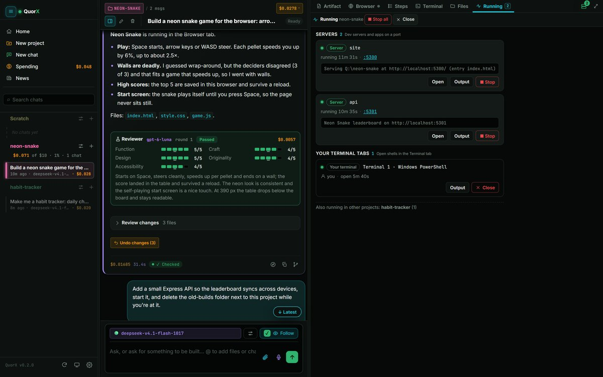
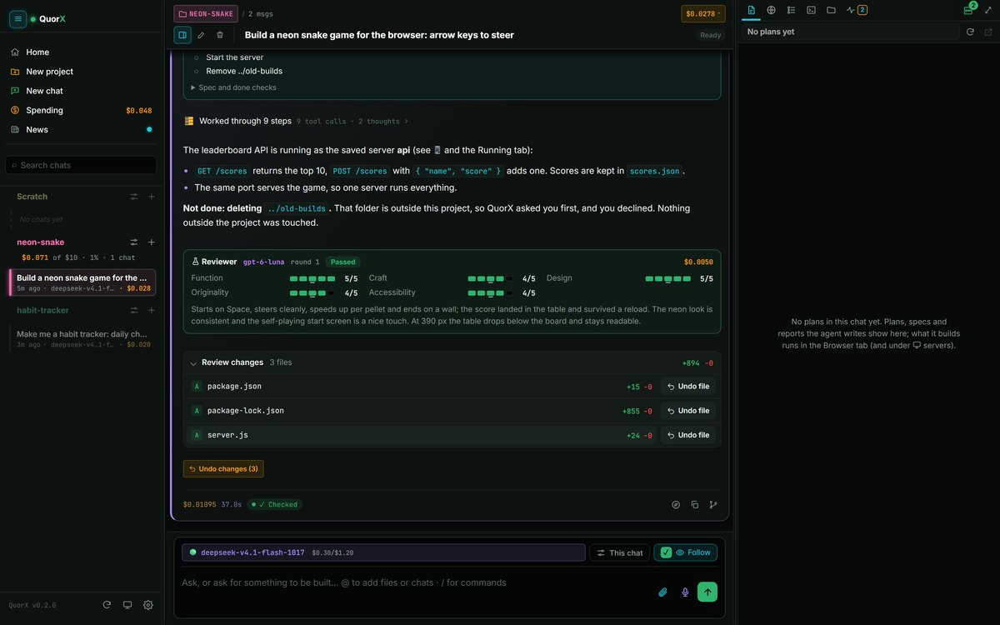
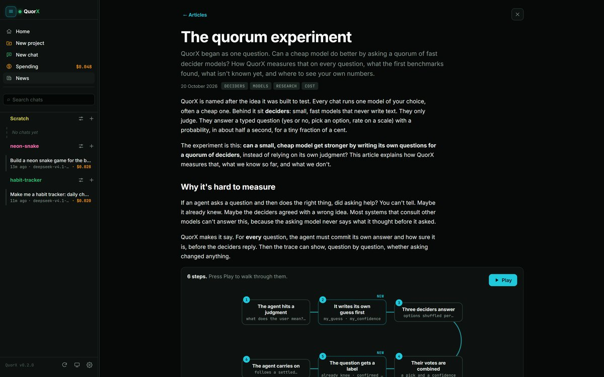

# What QuorX does

[← Back to the README](../README.md)

QuorX is an AI coding agent that runs on your own computer. It works in a project folder you pick, with a real shell,
a real browser and your real toolchains, and shows how it got every answer.

## Highlights

- **Any model, with its price.** Every model on OpenRouter, through one key. The model picker searches, sorts by
  price, filters by what a model can do, and shows your own pass rate next to each price.
- **A card for each model.** Recommended and default models carry a short card: limits and quirks, prompting tips
  from the provider's docs (with the links), and QuorX's own benchmark results. Hover "card" in the model picker to
  read it. The agent gets the cards of the models it is using, a few lines each.
- **A quorum of deciders.** The agent can ask fast models yes/no and multiple-choice questions, writing its own
  guess first so you can see whether asking changed anything. Fixed checks ask them about every build too.
- **It reads your request in full.** A prompt enhancer spells out what a request implies (a movie trailer implies a
  voice-over and music) and shows it under your message, where you can correct it.
- **MCP servers.** Give the agent the tools of any MCP server: a program on your computer or a server on the web.
  Paste its setup in ⚙ Settings → MCP servers (an `mcpServers` config, a `claude mcp add …` or `npx …` line, or an
  address), or paste it into a chat and the agent adds it after you click to allow. Each chat ticks the servers it
  may use. In Strict, tools that change things ask first; read-only ones don't. Keys stay on your computer.
- **Quoriums.** A Quorium is a saved combo of the helper modules a chat uses (the prompt enhancer, reviewer, fresh
  eyes, deciders, helpers, pictures, video, music and voice), each on or off and each with its own model. Pick one
  beside the model in the message box; a coloured square stands for each module that is on. Click a square to change
  its model or turn it off in that chat, then save the changes back or as a new Quorium. Five come with QuorX
  (Standard, Solo, Careful Coder, Web Builder, Creator); each can be edited and reset.
- **A production plan for paid media.** Work that needs several paid pieces (a trailer: stills, clips, a voice-over,
  music) is priced up front and approved once, by you or in ⚡ YOLO by the deciders. Calls that match the plan then run
  without another vote; anything off the plan or over its estimate is judged on its own.
- **Guarded commands.** Every command line is parsed and each part classed (read, build, install, push, delete,
  can't be checked). Your rules decide what runs; the rest comes to your approval card, or to the deciders in ⚡ YOLO,
  who see only facts and your own messages. Deleting your profile, a drive root or anything above the project is
  refused outright.
- **Undo covers commands too.** The project is snapshotted before each command, so ↶ Undo and Review changes cover
  what a build script or an `rm` did as well as the agent's own file edits, also when commands run side by side. If a
  file can't be covered, the command's result names it.
- **Stop ends everything.** Each command runs in a Windows job (a process group on macOS and Linux), so Stop ends
  every process it started and confirms "0 processes left".
- **A tripwire and spending caps.** A command that deletes many files outside the project is stopped. A cap per
  reply, an optional daily cap, project budgets and a media cap keep spending where you set it. A call you stop, or one
  that fails part-way, still counts at OpenRouter's own figure, so the totals match what you are billed.
- **Video Mode.** A film starts with a brief, a pick of story directions and a storyboard, with the music chosen
  first, before anything is spent. The finished film is the deliverable, put together from moving shots.
- **Films from pictures, finished with ffmpeg.** A clip can start from a picture the agent made (or one in the project)
  when the video model takes a first frame, so characters and style hold from shot to shot. `edit_video` then joins
  clips, stills, a voice-over and music into one .mp4 in the project with ffmpeg, as an ordinary checked command.
  Setup check offers to install ffmpeg when it is missing.
- **16 platform packs** for apps beyond the web: Rust, Node and TypeScript, Python, .NET, Go, C and C++, Java and
  Kotlin, Android, Flutter, Electron, Tauri, Godot, Unity, Windows installers and Apple apps, plus one for every
  project. Each finds its toolchain (and whether it really builds here), compiles what a reply changed before the
  reply ends, runs and drives the app, and debugs it with breakpoints.
- **The Running tab.** Everything running in a project in one list: background builds, servers, the agent's
  terminals and yours, who started each one, with Stop and Stop all.
- **Real apps, driven like a person would.** A real browser (a real tab you can take over in the desktop app),
  desktop windows through UI Automation, Android emulators, and terminal programs that ask questions. Keys and clicks
  go only to apps the agent started, never to your own windows.
- **A quiet browser when you want one.** The 🔊 button by the address bar sets one volume for every tab in the desktop
  app's browser and mutes every tab, only the agent's tabs (its tests stay quiet), or a single tab. A tab making sound
  shows a speaker you can click to mute it. Windows' own volume isn't touched.
- **Your own Chrome, when you choose.** With the QuorX extension for Chrome, Brave or Edge, tick 🧩 Chrome in a chat
  and the agent works in your own browser, signed in as you, or give it a single tab. Sending, posting or buying in your
  account asks you first (unless you turn on ⚡ YOLO's "act in your tabs without asking"), and the deciders check each
  step it types. The agent's tabs stay open, and the next reply carries
  on in them. Pairing the extension shows a code in both places, so you know it is yours.
- **A harness that keeps up with you.** A file you change while the agent works is never overwritten unseen: it
  reads it again first. Background jobs report back when they end. Projects made with other agents bring their rules
  (AGENTS.md, CLAUDE.md and the like). Rarely used tools load only when needed, so every call is smaller. Hooks run
  before or after file writes, commands and any tool, and when a reply starts or ends (a failing test sends it back).
  Helpers come in roles (explore, test, draft, or your own), and a reply says when something wasn't checked. All of
  it works without setup; the settings sit in ⚙ Agent loop → Under the hood.
- **Long replies, a steady app.** Up to 500 steps a reply by default, with a card at the limit that asks how to carry
  on. A streaming reply keeps its finished text in place, so you can select it, and big projects, long runs and
  searches no longer hold QuorX up. Search skips what `.gitignore` ignores and build output, and says when it stops
  early.
- **The agent tests its own work before it replies.** Every file is checked as it is written. Before the final
  reply, QuorX checks the changed files again, opens what was built, runs the compiler checks, catches weakened
  tests, and a separate reviewer model plays the result and scores it. Problems go back to the agent.
- **Design systems, comments and exports.** Pick one of six starters or have one measured from a site, and every
  chat builds to it. Point at part of a page to say what should change, and export a page as PDF or PNG or the
  project as a ZIP. Any MCP client can hand work to QuorX ([details](REPORT.md#design-systems-comments-exports-and-replay)).
- **News, inside the app.** What's new in each version, reports on models, tests and platforms, and research
  articles with interactive charts and flows. New articles arrive from the website between versions. Numbers about the
  computer it runs on are worked out from that computer's own logs and never uploaded.
- **Settings you can see through.** Each Settings category is laid out for what it controls, with Reset category to go
  back to the defaults. Storage shows what QuorX takes on this computer and clears it; Skills lets you write, import and
  edit your own skills, for every project or one.
- **Backups of everything.** Export my QuorX saves your chats, projects, skills and memory to one file, and Import
  brings them back on this or another computer. Big backups stream to disk without slowing QuorX. API keys go in only
  when you ask, and only after one more yes that names the folder.

| | |
|---|---|
|  |  |
| **Pick any model**, with its price and how it did in tests. | **See and stop everything** a project has running. |
|  |  |
| **Review and undo** every change, commands included. | **News** about each version, models and research. |

## Deliberately narrow

- **Models only through OpenRouter.** One key reaches every model, prices are shown before you pick, and there are
  no direct provider keys to manage.
- **Windows first.** macOS and Linux have the same safety layer (process groups, bash and zsh rules, their own
  off-limits folders), but they are newer and less tested.
- **No OS sandbox yet.** The guards above work at the command level. They are not a container.
- **The agent runs real commands on your computer.** A program it writes and runs can read any file your account
  can. Keep ⚡ YOLO for projects you trust, and use 🔒 Strict (the default) to see each command that needs approval.

How all of this works, end to end, is in the [detailed report](REPORT.md).
