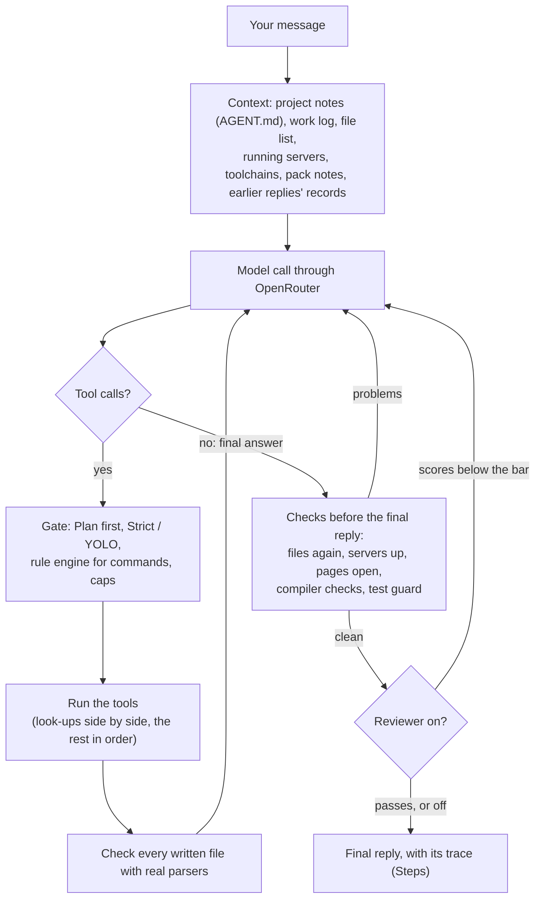
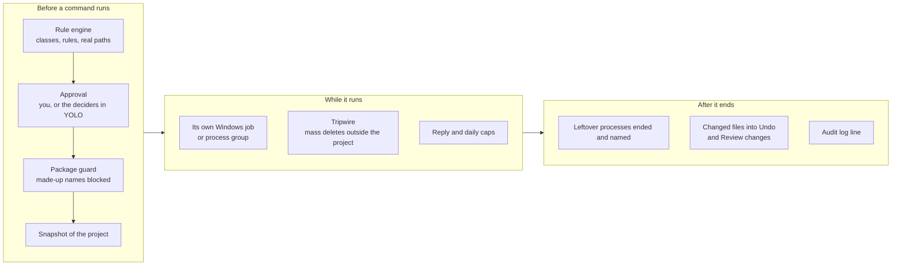
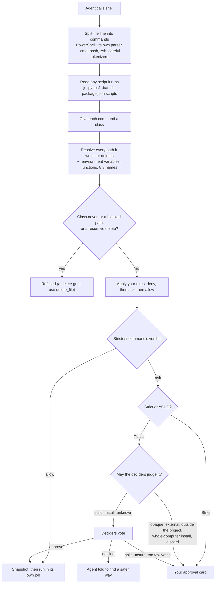
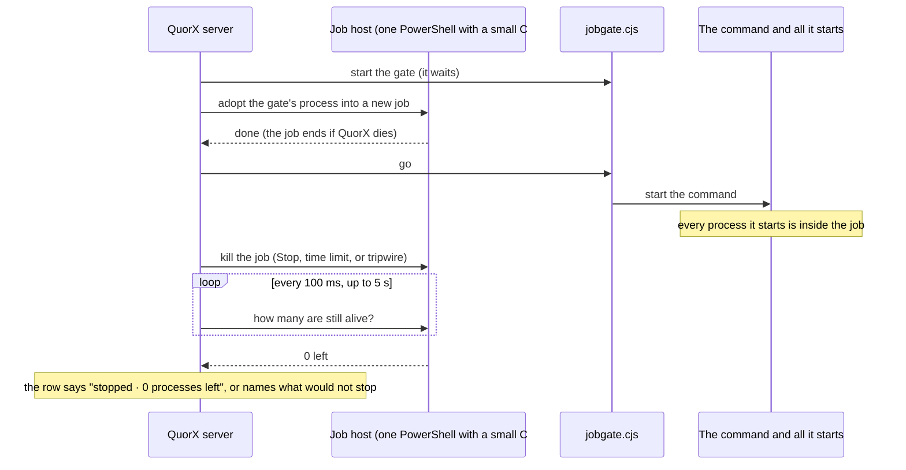
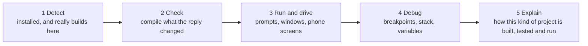

# QuorX: the detailed report

This report explains how QuorX works from end to end, what keeps it safe to run on your own computer, how it is
tested, and what was learned while building it. The [README](../README.md) is the short version. Every number here
was checked against the code or measured on 20 October 2026 (QuorX 0.1.5, Windows 11, Node.js 22).

## Contents

- [What QuorX is](#what-quorx-is)
- [How a reply runs](#how-a-reply-runs)
  - [The loop](#the-loop)
  - [Artifacts, projects and the project folder](#artifacts-projects-and-the-project-folder)
  - [Checks and review before the final reply](#checks-and-review-before-the-final-reply)
  - [Replies live on the server](#replies-live-on-the-server)
- [The deciders and the quorum experiment](#the-deciders-and-the-quorum-experiment)
  - [Decide with a guess](#decide-with-a-guess)
  - [Harness checks and look](#harness-checks-and-look)
  - [What the benchmarks found](#what-the-benchmarks-found)
- [The safety layer](#the-safety-layer)
  - [The shell tool](#the-shell-tool)
  - [The rule engine](#the-rule-engine)
  - [Scripts that run other programs](#scripts-that-run-other-programs)
  - [Paths and the delete guard](#paths-and-the-delete-guard)
  - [Who approves: you or the deciders](#who-approves-you-or-the-deciders)
  - [Stop that ends everything](#stop-that-ends-everything)
  - [Snapshots and Undo](#snapshots-and-undo)
  - [The tripwire](#the-tripwire)
  - [Spending caps](#spending-caps)
  - [Smaller guards](#smaller-guards)
  - [Logs that answer "who let this run?"](#logs-that-answer-who-let-this-run)
  - [Who can reach QuorX, and where keys go](#who-can-reach-quorx-and-where-keys-go)
- [The Running tab and background jobs](#the-running-tab-and-background-jobs)
- [Beyond web pages: the agent's hands](#beyond-web-pages-the-agents-hands)
- [Design systems, comments, exports and replay](#design-systems-comments-exports-and-replay)
- [QuorX as an MCP server](#quorx-as-an-mcp-server)
- [Platform packs](#platform-packs)
- [Testing](#testing)
- [Setup in detail](#setup-in-detail)
  - [Install and first start](#install-and-first-start)
  - [OpenRouter keys](#openrouter-keys)
  - [Ports](#ports)
  - [Phones and other devices](#phones-and-other-devices)
  - [Where data lives](#where-data-lives)
  - [The desktop app](#the-desktop-app)
  - [Settings from the environment](#settings-from-the-environment)
- [Research and decisions](#research-and-decisions)
- [Known limits](#known-limits)
- [Where the code is](#where-the-code-is)

---

## What QuorX is

QuorX is an AI coding agent you run on your own computer. You talk to it in a web page (or its desktop app); it
works in a project folder you pick, with a real shell, a real browser and real toolchains, and it shows how it got
every answer. Any model on OpenRouter can be the agent. Behind it sits a **quorum of deciders**: a few fast, cheap
models it can ask yes/no and multiple-choice questions, which also vote on risky actions when you let them.

QuorX started as an experiment: can a small, cheap model get stronger by writing its own questions for fast decision
models instead of relying on itself? To make that measurable, the agent must write down its own guess before it
asks. That experiment is still in the code (the `decide` tool and the benchmarks), and the same deciders now also
guard what the agent runs.

| Part | What it is | Where |
|---|---|---|
| Server | Node.js 20+, plain `http`, no framework. Runs replies, commands, servers, the browser and the deciders | `server.js`, `server/` |
| Web page | Plain JavaScript, no framework | `public/` |
| Desktop app | Electron window around the same page, with real browser tabs in the pane | `desktop/` |
| Platform packs | One file per kind of app beyond the web | `server/packs/` |
| Dependencies | `node-pty` and xterm.js for terminals; the desktop app adds Electron in `desktop/` only | `package.json` |

---

## How a reply runs

### The loop

A reply is a tool loop on the server. The model reads the conversation and the project's context, calls tools, gets
their results, and repeats until it gives a final answer. Before that answer goes out, the harness checks the work.



| Part | What happens |
|---|---|
| Steps | Up to 60 model calls per reply by default (editable up to 120). Each tool result ends with a meter such as `[steps: 12 of 60 used · media: $0.02 of $0.50]`. At 80% the agent is told to wrap up; after 8 steps of only looking around it is told to make the changes. When the steps run out while the plan still has open items, up to 2 extra rounds of half the limit follow; "Keep going" on the card gives 30 more. |
| Retries | A failed model call (rate limit, network, provider error) is retried up to 3 times with growing waits. Bad requests aren't retried. A 402/403 key-limit refusal stops the reply instead. |
| Thinking can't eat the answer | Reasoning low / medium / high gets about 3k / 8k / 16k tokens of thinking, never more than 25% of the output limit (64k tokens per call by default). A call that comes back with only thinking is retried with less reasoning, at most twice. |
| Look-ups together | Up to 4 neighbouring reads, listings, searches, fetches or skill loads in one step run at the same time. Writes and commands run alone, in order. |
| Reading and editing | `read_file` returns numbered lines, 400 at a time. `edit_file` takes one find/replace or up to 20 edits, applied all or none. |
| Long replies | Past 120k characters, old file bodies in the conversation are swapped for short notes, in batches so the provider's prompt cache stays warm. Past about 24k characters of chat history, older turns are summarised once. |
| Loop detection | The same tool call 4 times, or the same error 3 times in a row, gets a nudge. The second time, Strict asks you whether to keep going, and YOLO wraps up. |
| Fresh eyes | When the same problem shows up a second time, a clean-context model diagnoses it before the next step (up to 3 times per reply). |
| Outside text | Pages from `fetch_url` and outside sites are labelled untrusted, and lines that read like orders to an AI are removed. |
| What earlier replies did | Each tool call is recorded in one line. The record and how a reply's checks ended go into the next reply's prompt as a harness record, never as the agent's own words (models copy that format and fake it otherwise). |
| Plan first | Off by default. With "Big tasks" or "Always", the agent's first plan waits on a card: Go ahead, Stop here, or type what to change. File changes, commands and servers wait for Go ahead; reading is fine. |
| Questions | `ask_user` sends up to 4 questions in one card, each with a recommended answer ticked. In YOLO the deciders answer them. The agent never asks you to pick a visual style: it chooses and says what it chose. |
| Helpers | `delegate` hands a read-only job (explore, find, summarise) to a cheaper model with a clean context, `qwen/qwen3.7-flash` by default. Only its short report comes back. |
| Routing | OpenRouter's own order by default (it favours providers with reliable tool calling); cheapest or fastest instead; only providers that support every parameter; optionally zero-data-retention providers only; an optional fallback model. |
| Scorecard | One line per reply in `logs/runs.jsonl`: model, how it ended, steps, tools, retries, checks, cost and time. `npm run scorecard` sums it per model, and the model picker shows your own pass rate next to each model's price. |

The agent's tools, as the server defines them: files (`list_files`, `read_file`, `write_file`, `append_file`,
`edit_file`, `delete_file`, `search_files`), `shell`, `terminal`, `job_output`, `job_stop`, `start_server`,
`stop_server`, `preview_site`, `browser`, `look`, `desktop`, `android`, `debug`, `fetch_url`, `plan`, `ask_user`,
`decide`, `delegate`, `use_skill`, `save_skill`, `scaffold`, `write_artifact`, `edit_artifact`, `read_artifact`,
documents (`list_docs`, `search_docs`, `read_doc`), and paid media (`imagine`, `make_video`, `compose_music`, `speak`).
The reviewer has its own `submit_review`. The old `run_command` (one allow-listed program) still works for older
chats and goes through the same rule engine as `shell`.

### Artifacts, projects and the project folder

- **A project is a folder you pick**, such as a repo. Many chats can share one project and
  work in the same files. A project is named after its folder. Picking a folder inside QuorX itself is refused, and a folder that
  disappears is noticed (sending waits until you reselect it).
- **The agent's own files** sit in a hidden `.quorx/` folder in the project: undo checkpoints, trash, the snapshot
  store, scratch work, uploads, the plan, launch configs, skills and the work log. A `.gitignore` of `*` inside it
  keeps it out of git without touching yours. Research and throwaway scripts go in `.quorx/scratch/`. When the folder
  passes 500 MB (editable), the chat offers to clear scratch, empty the agent's trash or trim undo history, and the
  agent asks before adding more.
- **Project memory:** `AGENT.md` holds the project's notes, which every chat gets and the agent keeps current.
  `.quorx/log.md` gets one line per reply that changed something; the last 15 lines are in every chat's context.
- **Artifacts are for planning:** plans, specs, research notes, reports and comparisons, as Markdown or a
  self-contained HTML page, hosted by the server at `/art/<chat>/<id>` and shown in the pane. Hosted pages run
  sandboxed and can't call QuorX's API. What the agent builds (sites, apps, games, tools) lives in the project folder
  and runs as a server or a program.
- **Servers** get a free port from 5300 to 5999 in `PORT` (and `{PORT}` in their arguments), are saved to
  `.quorx/launch.json` (a `launch.json` in another agent tool's settings folder is read too) and are listed under 🖥 with Run, Stop, Restart and Edit.
  Servers still start only from a short list of programs: node, npm, npx, python, pip, deno, bun, pnpm, yarn and uv.
  Commands of any kind go through `shell`.
- **Skills and templates:** built-in playbooks in `skills/` (`web-app`, `design-craft`, `design-system`, `node-server`,
  `canvas-game`, `ui-review`, `debug-loop`, `decide-well`, `video-direction`) load with `use_skill`; the agent can save its own after a
  task that took several tries. `scaffold` copies a starter from `templates/` (static site, Node server, canvas game,
  Python server) without overwriting anything.
- **Documents:** attach files of any kind. Text, code, PDF, Word, PowerPoint, Excel, OpenDocument, EPUB and HTML are
  read. Small ones go into the message whole; big ones are embedded once and searched with `search_docs` and
  `read_doc`. Indexing over $0.50 waits for your OK.

### Checks and review before the final reply

QuorX doesn't take the agent's word that something works. Four layers check it, from cheap to expensive:

| Layer | When | What it checks |
|---|---|---|
| File check | After every write | Real parsers: `node --check` for JS, Python's parser, JSON, CSS braces, inline scripts, import maps and local links in HTML. Problems come back in the same tool result. A design lint gives advice on HTML and CSS (never a failure). |
| Final checks | When the agent tries to finish | Every file the reply changed, again; dev servers it started are still up; each page, site and app it built opens in the headless browser without script errors, failed loads or a blank page. |
| Compiler checks | Same moment | From the platform packs: `cargo check`, `dotnet build`, `go vet`, `tsc --noEmit`, CMake, Gradle or Maven, `flutter analyze`, Godot, Unity, WiX and more. Each runs once per project folder the reply changed, only when the toolchain is installed, and only errors in files this reply changed count. |
| Test guard | Same moment | Each test file the reply changed is compared with its undo copy. Fewer assertions, skipped tests or a deleted test file are reported, so the agent must restore them or explain. |
| Reviewer | After the checks pass | A separate model with a fresh context plays what was built in the browser and scores function, craft, design, originality and accessibility (1 to 5), plus brand fit when the project has a `DESIGN.md`. Below the bar (3), the builder fixes the bugs, 1 round by default. On by default for builds the agent planned. |

Any problem sends the agent back (up to 2 rounds for checks, by default). What is still wrong after that is listed in
the reply, and the footer says **✓ Checked** or **⚠ N problems left**.

### Replies live on the server

A reply runs on the server. Every event goes to `data/runs/<reply>.jsonl`, and a checkpoint is
saved after every step. Closing or reloading the page doesn't stop a reply: the page reattaches and replays what it
missed. If QuorX restarts mid-reply, the reply shows ▶ Resume and carries on from its last finished step. Several
chats can run at once; chats in the same project share its folder and servers.

---

## The deciders and the quorum experiment

The deciders are three fast models by default: `typesafe/jev-1.14`, `liquid/d1-ultra` and
`openai/gpt-6-luna-decisions` (up to 5, editable). They answer structured questions (yes/no with a probability, or a
choice among options) and their votes are averaged.

### Decide with a guess

Every agent has a `decide` tool and chooses itself when a judgment is worth asking about. For each question it must
first commit `my_guess` and `my_confidence`. The deciders then answer, with choice options shuffled per decider, and
the question gets a label:

| Label | Meaning |
|---|---|
| already knew | The deciders agreed with a guess the agent was already at least 80% sure of. |
| confirmed | The deciders agreed with a guess the agent was unsure of. |
| changed answer | The deciders confidently disagreed. This is where asking pays off, or does harm. |
| deciders unsure | The deciders couldn't settle it (confidence below 0.5). |

The deciders always see your latest message word for word, plus the agent's short notes labelled *unverified*, with
a rule that your message wins. They can look at images: your attachments, the page open in the agent's browser, or
one of its artifacts. Every question goes to `logs/decisions.jsonl`.

### Harness checks and look

The agent writes its own questions, but small models don't always know what to ask. So QuorX also asks fixed
questions at fixed moments (`server/harness-checks.js`): a **gap** check before a build (is this a build, and what
does the request leave out?), a **shot** check on a screenshot after a preview, and a **click** check comparing
screenshots before and after clicking the page's main control. `look` lets the agent screenshot a page and send it
with its own yes/no checks ("A Reset button is clearly visible"), guessing first. These use one decider that reads
pictures well, and the others only when it is unsure.

### What the benchmarks found

`scripts/bench.mjs` runs known-answer tasks under several setups with the same small model: **A** alone, **C** asks
the deciders first, **D** writes 3 drafts and the deciders pick one, **D2** adds a majority vote and a fallback, and
**E** is a frontier model alone. Results from 18 October 2026 (about $1 in all):

| Small model | A alone | C asks first | D drafts + pick | Notes |
|---|---|---|---|---|
| DeepSeek V4.1 Flash | 98% | 98% | 98% | At the ceiling: 42 of 45 questions were "already knew" |
| Ling 3.0 Flash | 91–94% | **98–99%** | 94–96% | Its own questions changed its answers: 7 changes in 79 questions, all to the right answer |
| Qwen 3.7 Flash | 87–95% | 88–98% | **95–100%** | Its questions echoed its first reading; its drafts varied enough for the deciders to find the right one |
| Claude Opus 5.5 (E) | 100% | | | About $0.007 per task |

What this says, with the caveat that 41 + 40 tasks with at most 2 runs each put differences of 1 to 3 tasks within
noise:

- A strong small model gains nothing; asking is theatre.
- For weaker models it depends on the model: Ling gained most from asking, Qwen from drafts. The best weak model
  with its best helper scored 98–100%, against 100% for Opus, at roughly 1/25 to 1/70 of the price.
- **The agent's misreading used to reach the deciders.** Qwen retold a modified riddle as the classic one and the
  deciders confirmed the wrong answer. Adding the user's own words wasn't enough while the agent's confident notes
  still pulled them to P=0.77. With the notes labelled *unverified* and "the user's message wins", the same deciders
  gave P=0.04. QuorX now does both.
- **A majority of drafts from one model is a weak signal.** Their errors are correlated (two drafts often share
  the same memorised wrong answer). Letting the majority overrule the deciders' pick was right 1 time in 5; a
  confident pick overruling the majority was right 3 times in 3.
- The fixed strategies (forced asking, drafts) stay in the benchmark only. In chats, the agent decides when to ask.

A third set, `--set build`, runs 9 real build tasks (5 browser games, a dashboard, 3 form tools) through the full
harness in throwaway folders and has a judge model play each build. It is the set that shows whether a harness
change makes builds better. The strong reviewer (Claude Sonnet 5.5) agreed with the judge 7 times in 7 there.

**Other agent CLIs as builders:** `--mode cli:claude` or `cli:codex` has that agent CLI build the task in its
throwaway folder, and the same judge scores what it leaves. Each CLI is one data object in `server/clis.js`
(program, arguments, prompt on stdin, how to read its answer); more can go in `bench/clis.json`. They run only in
the benchmark, because QuorX's approvals can't reach inside another agent: each CLI's own flags limit it to editing
files in that folder, arguments are fixed flags or a checked model id (`--cli-model`), and no task text reaches a
command line. These runs use that CLI's own account, not OpenRouter.

---

## The safety layer

The agent runs real commands on your computer. The rule behind the safety layer was to ship the guards together with
the open shell, never after it. The plan, with every decision and its reasons, is in
[shell-safety-plan.md](shell-safety-plan.md); this section describes what was built.



### The shell tool

`shell({ command, cwd?, background? })` runs a command line in the project folder.

| | Default | Range |
|---|---|---|
| Shell on Windows | Windows PowerShell 5.1, read by its own parser | `pwsh`, `cmd`, or Git Bash (opt-in) |
| Shell on macOS and Linux | bash | `zsh` |
| Time limit | 180 s | 5 to 900 s; a command still running at the limit moves to the background instead of being killed |
| Input | closed: the agent is told to pass non-interactive flags | `terminal` for programs that need a keyboard |
| Environment | yours, with API keys, tokens and secrets removed | |
| Output | the last part goes back to the agent; the full log is saved in `.quorx/scratch/logs/` | |
| Memory cap per command | none | any number of MB (Windows only) |

### The rule engine

`server/cmdpolicy.js` decides, before anything runs, whether a command line runs, asks, or is refused. Nothing in it
runs the command.



**Classes.** Every command in a line gets one. The whole line takes the strictest.

| Class | Examples | Strict | YOLO |
|---|---|---|---|
| read | `git status`, `Get-ChildItem`, `cat`, `<tool> --version` | runs | runs |
| write | `New-Item`, `Copy-Item`, `mkdir` inside the project | runs | runs |
| build | `cargo build`, `dotnet test`, `go build`, `npm run x`, `node app.js` | asks until a rule allows it | a rule, else the deciders vote |
| install | `npm i x`, `pip install x`, `cargo add x` | asks | the deciders vote |
| install, whole computer | `winget`, `choco`, `scoop`, `rustup`, `npm -g`, `brew`, `apt`, `sudo` + an install | asks | asks you |
| external | `git push`, publishing, deploy CLIs (`gh`, `vercel`, `aws`, `kubectl`…) | asks | asks you (unless you ticked "YOLO may approve external actions") |
| opaque | `python -c`, `node -e`, `cmd /c`, `iex`, `Start-Process`, `& $var`, UNC paths, ending other programs | asks | asks you (unless ticked) |
| discard | `git clean`, `git reset --hard`, `git restore .` | asks | asks you |
| delete | `Remove-Item`, `rm`, `del`, `rimraf` | see [the delete guard](#paths-and-the-delete-guard) | same |
| never | `format`, `diskpart`, `bcdedit`, `reg add HKLM`, `Set-ExecutionPolicy`, `net user`, `-Verb RunAs`, `sudo` + anything but an install | refused | refused |
| unknown | everything else | asks | the deciders vote |

**Rules** have the form `{ effect: allow | ask | deny, match: "cargo build*" }` and live per chat, per project
(`<project>/.quorx/permissions.json`) or everywhere (`data/permissions.json`).

- Deny beats ask beats allow. A rule can always make a class stricter.
- A rule can lift *ask* to *allow* for read, write, build, install and unknown. It can lift opaque, external,
  discard and whole-computer installs only if you typed or edited it yourself; a rule made by a button click or by
  the deciders never does. Nothing lifts *never* or a blocked path.
- Rules match the parsed command (program and arguments), never the raw text, so `cargo build; rm -rf x` can't ride
  on a `cargo build*` rule.
- In YOLO, wildcard rules on interpreters and package runners (`python*`, `node*`, `npx*`, `powershell*`…) are
  ignored, because they would allow any code.
- The approval card offers **Always allow…** with two segmented choices: what (this exact command, commands starting
  with…, any command of this program) and where (this chat, this project, everywhere). Projects get suggested rules
  for the toolchains they use (by `Cargo.toml`, `*.csproj`, `go.mod`…), unticked until you tick them.
- ⚙ Settings → Safety & commands has a **Test a command** box that shows what the engine would do, and why.

### Scripts that run other programs

In a real chat the agent wrote `.quorx/scratch/run.mjs`, a script that runs whatever command it is given, and ran
`node .quorx/scratch/run.mjs rustup toolchain install …`. The rules saw only "node runs a project script", a build.
Since then, the engine reads a script before it runs (up to 1 MB, plus the local modules it loads and the scripts
it runs, a few levels down):

- A JavaScript or Python script that launches programs (`child_process`, `execa`, `subprocess`, `os.system`,
  `Bun.spawn`…) or builds code while running (`eval`, `new Function`) is **opaque**: it asks you, gets no Always
  allow, and can't run in the background.
- A launcher that passes its own arguments on (`process.argv`, `sys.argv`, `$args`, `%*`) has those arguments judged
  as a command of their own. The case above now shows `rustup toolchain install … · install · whole computer · run by
  .quorx/scratch/run.mjs`.
- PowerShell, batch and shell scripts are split into their commands with the same parsers. Dangerous lines inside
  become commands of the line ("inside setup.ps1").
- `package.json` scripts are read too: `npm run x`, `npm test`, `npm start`, `yarn x`, `pnpm x`, `bun run x`, and a
  bare `npm install` or `npm ci` (which run install hooks), with their `pre` and `post` hooks. `cross-env`, `npx`,
  `concurrently` and `run-s`/`run-p` are looked through. A plain `"build": "tsc"` stays a build.
- A script that can't be named before it runs (`node $f`), or that the same line writes first, is opaque.
- The agent is told to run each program directly and never write wrapper scripts.

Not read yet: a top-level `npx tsx file.ts` and `uv run file.py`.

### Paths and the delete guard

Every path a delete, move or write touches is resolved to its real target: `~`, `$env:X`, `%X%` and `$HOME` with the
values the command will see, relative to its folder, then through junctions, symbolic links and 8.3 short names.
Anything that can't be resolved (an unknown variable, a wildcard in the first part of a path) asks you.

| Where | What happens |
|---|---|
| A drive root, your profile and the folders directly in it (Desktop, Documents, Downloads, OneDrive, AppData…), `C:\Windows`, Program Files, ProgramData, other people's profiles, any folder above the project, the project folder itself, QuorX's own folder, `.git`, `.quorx` (except scratch) | Refused. No rule, decider or YOLO can lift it |
| macOS and Linux: `/`, your home and its folders, system folders, `~/Library`, `~/.ssh`, `~/.gnupg`, mounted drives | Refused |
| Inside the project, named files | Run (the snapshot covers them) |
| Inside the project, a recursive delete or more than 20 files | Refused, with "use `delete_file`": it moves files and folders to `.quorx/trash`, so you can get them back |
| Outside the project but not blocked (a sibling folder) | Asks you in both modes (YOLO's deciders only if you ticked "YOLO may approve outside deletes") |

The agent's own file tools can't write QuorX's config either: `.quorx/` (except scratch, and skills through
`save_skill`), `.git/` (hooks are code), other agent tools' settings folders, `.vscode/tasks.json` and
`.vscode/launch.json` are refused. This
keeps the agent from planting a command that you, or git, would run later. Build commands in a project's own agent
instruction files (such as `AGENTS.md`) are only ever shown as suggested rules, so a cloned repo can't grant itself permissions.

### Who approves: you or the deciders

Each chat has a mode, 🔒 **Strict** or ⚡ **YOLO**.

| | Strict | YOLO |
|---|---|---|
| Commands that ask | Your card: Run once, Always allow…, Deny (with a reason the agent reads) | The deciders vote on build, install and unknown; everything else asks you |
| Paid media (pictures, video, music, voice) | Your card, with the price and a model menu | The deciders vote "needed?" and "fair price?" (untick for no check) |
| Other tools | Run (or ask for every tool, if you choose "every") | Run |
| `ask_user` questions | Your card | The deciders answer |
| Per-reply media cap ($0.50) and the project budget | Enforced by code | Enforced by code |

**The judge** (`server/approvals.js`) is one function for every approval the deciders handle. It was hardened after
the research for this layer:

- It sees only your own messages and facts the harness computed (the command, its classes, real paths, the price),
  never the agent's reasons, its plan, tool output, file contents or web pages. Those are where injected instructions
  hide. The media prompt is passed as data, labelled as written by the agent.
- A decider may not be the chat's own model.
- At least 2 valid votes are needed (the quorum). A command is approved only when "the user's messages ask for it"
  reaches P ≥ 0.7 and "it could harm files outside the project, leak data or cost money" stays at P ≤ 0.2, both with
  a settled or leaning verdict.
- A failed vote, a split or an unsure result goes to you. It never defaults to approve.
- After 3 blocks in a row, or 20 in one reply, commands that need a vote ask you for the rest of that reply.

### Stop that ends everything

Before, Stop sent an abort and ran `taskkill /T`, which misses a grandchild whose parent has already exited. Now every
command, server, debugger and agent terminal starts inside a **Windows Job Object**:



- **No escape at start:** the command only runs once it is inside its job.
- **QuorX crashes, everything ends:** jobs are created with kill-on-close, so if QuorX or the job host dies, so does
  every agent process.
- **Leftovers are swept:** when a command ends by itself, anything it started that is still running is ended too,
  and named in the result.
- **macOS and Linux** use process groups behind the same functions (`server/procgroup.js`): the gate starts in a new
  session, Stop sends SIGTERM then SIGKILL to the group and counts again, a child that leaves its group (`setsid`)
  is still followed, and each gate ends its own group if QuorX goes away.
- **Basic mode:** if the job host can't start (PowerShell blocked by policy, or `QX_NO_JOBHOST=1`), commands still
  run and Stop falls back to killing the process tree. ⚙ Settings → Safety & commands → Stop says which mode is on.
- The same job host also runs PowerShell's parser for the rule engine, so one helper process does both.

### Snapshots and Undo

Undo used to cover only the agent's file tools. A build script or an `rm` in a command was invisible to it. Now,
before every command that isn't read-only (and before a server starts), the project is snapshotted
(`server/snapshot.js`):

- Files are stored by content in `.quorx/objects/` with an index (`.quorx/snapindex.json`) of size, time and hash, so
  only changed files are read again.
- Skipped: dependencies, version control, build output (`node_modules`, `.git`, `.venv`, `dist`, `target`, `bin`,
  `obj`, `build`, `out`, `.gradle`, `cmake-build-*`…) and files over 20 MB. Past 1 GB of project files, snapshots
  pause and the command row says so.
- After the command, every file it added, changed or deleted gets its before-state copied into the reply's normal
  checkpoint. **↶ Undo changes**, **Undo file**, **Review changes**, conflict checks ("this file changed since") and
  pruning all work the same for commands as for file edits.
- Undo is kept for the newest 10 replies per project, for at most 7 days. For history that lasts, use git.
- What Undo can't cover is said on the command row: files outside the project, ignored folders, and anything that
  left the computer (pushes, installs, databases).

### The tripwire

The rule engine can't see a delete made by the project's own code: a build script, `shutil.rmtree` in your Python,
or a bug in the agent's program. While a command runs, `server/tripwire.js` watches your profile (minus AppData,
Library and caches), the project's parent folder and the project's `.git`. When 25 files vanish there within 3
seconds (both editable), it stops the command's job and shows a red banner with the paths and where to look (Recycle
Bin, Previous Versions).

It is best effort by design: it reacts after the fact, it only sees what the system's change notices report, and it
says so. Files the command made itself (installers unpack into temp folders and delete them again) don't count. On
Linux, where every folder needs its own watch, your home is watched one level deep.

### Spending caps

| Cap | Default | What happens |
|---|---|---|
| Media per reply | $0.50 | A paid picture, video, music or voice call that would pass it is declined, in both modes |
| All spend per reply | $1.00 | Counts the agent, deciders, helpers, checks and media. At 85% a wrap-up nudge; at 100% Strict asks to raise it for this reply, YOLO stops with a summary |
| Today, all projects | off | When set and reached, Strict asks to raise it, YOLO stops the reply |
| Project budget | none until you set one | Counts every chat in the project, including stopped replies and deleted chats. At 85% the agent is told to finish; a running reply may go up to 10% past to finish its work, then it is force-stopped. A new reply can't start once it is used up |
| OpenRouter key limit | yours, set on openrouter.ai | A 402/403 limit error stops the reply with a clear message, with no retry and no fallback model |

### Smaller guards

| Guard | What it does | Where |
|---|---|---|
| Package guard | Before an install, each package name is looked up on its registry (npm, PyPI, crates.io, NuGet). A name that doesn't exist is blocked (models invent plausible names, and attackers register them). A very new or barely used one asks you, even in YOLO. A registry that can't be reached is reported, never treated as fine | `server/pkgguard.js` |
| Test guard | Fewer assertions, skipped tests or a deleted test file are sent back before the final reply | `server/testguard.js` |
| Loop watch | Same call 4 times or the same error 3 times: a nudge, then you decide (Strict) or it wraps up (YOLO) | `server/agent.js` |
| Debugger gate | The debugger opens only after failed tries (setting: after failed tries, always, off) | `server/agent.js` |
| Android phones | The `android` tool uses emulators only, unless you tick "physical phones" | `server/android.js` |
| Desktop windows | The `desktop` tool reads and clicks only windows of the agent's own background jobs, never yours | `server/uia.js` |
| Browser | The agent's browser can't open QuorX's own pages; outside pages are labelled untrusted | `server/browser.js` |

### Logs that answer "who let this run?"

| Log | One line per |
|---|---|
| `logs/audit.jsonl` | Every command (what ran, who let it run, its exit code, how many files it changed), every block, every rule added, every tripwire. ⚙ Safety has a viewer |
| `logs/approvals.jsonl` | Every decider vote on an action: each voter's model, answer and cost, the quorum, the final verdict and who decided |
| `logs/decisions.jsonl` | Every `decide` question: guess, confidence, the deciders' pick and the label |
| `logs/checks.jsonl` | Every harness check, with its screenshot in `logs/check-shots/` |
| `logs/runs.jsonl` | Every reply: the scorecard and the cost ledger the budgets read |

Every command row in a reply also shows the layer that decided it (`rule: project`, `you`, `deciders 3/3`,
`class: read`).

### Who can reach QuorX, and where keys go

Anyone who reaches QuorX can make it run commands, so `server/access.js` limits who can:

- This computer (loopback) always may. Other devices must be paired once (see [Phones and other
  devices](#phones-and-other-devices)).
- The Host header must name this computer (localhost, an IP address or its own name), so a web page can't reach
  QuorX through DNS rebinding. Other names (a Tailscale name, say) go in `OH_ALLOWED_HOSTS`.
- Other sites, and pages the agent builds (dev servers, sandboxed artifacts), can't call `/api`.
- Keys live only in `data/keys.json` (git-ignored). The page only ever gets them masked, agent processes run with
  keys, tokens and secrets removed from their environment, and the agent's file tools can't read `.env` or
  `data/keys.json`. A program the agent writes and runs could still read any file your account can, which is why
  YOLO is for projects you trust and why there is a [known limit](#known-limits) on sandboxing.

---

## The Running tab and background jobs

The agent keeps working while long things run. The pane's **Running** tab is where you see all of it and end what
you don't want (`server/running.js`):

| Group | What it lists |
|---|---|
| In the background | Commands that went on running after the agent moved on |
| Running now | Commands the agent or you are waiting on |
| The agent's terminals | Programs the agent drives with keys (prompts, menus, REPLs) |
| Servers | Dev servers and apps on a port |
| Your terminal tabs | Open shells in the Terminal tab |

Each row shows who started it (you or the agent, and from which chat), how long it has run and its last output
lines, with ■ Stop. **■ Stop all** ends every command, background job, server and agent terminal in the project
(your terminal tabs stay open). It also counts what runs in other projects, so nothing is forgotten.

**Background jobs** (`server/bgjobs.js`) come two ways:

- The agent starts one with `background: true` (a desktop app, a watcher, a test server). Only commands that read,
  write inside the project or build may do this; installs, pushes and deletes can't.
- A command still running at its time limit moves to the background instead of being killed. A long build, or an
  install stopped part-way, would be wasted work or a half-installed tool. If its last output looks like a prompt,
  the agent is told that a background job never gets input.

A background job is still a normal agent command: in its own job, with its tripwire, in the terminal feed, with its
full output in a log file. The agent reads new output with `job_output` and ends it with `job_stop`. When you stop
one from the page while the reply still works, the agent is told before its next step.

---

## Beyond web pages: the agent's hands

| Tool | What it drives | How | Limits |
|---|---|---|---|
| `browser` | Pages, sites, apps it served, any http(s) URL, and Electron or WebView2 windows of apps it started (`cdp:<port>`) | Headless Edge or Chrome over the DevTools protocol, no dependencies. In the desktop app, the agent's tab is a real Chromium view you can watch | The final check always uses the headless browser |
| `look` | A screenshot of the page | Sent to a vision-capable decider with the agent's own yes/no checks | At most 3 rounds per issue |
| `terminal` | Programs that need a keyboard: prompts, menus, full-screen terminal apps, REPLs | A pseudo-terminal (ConPTY on Windows) inside a job, read through a small screen emulator, so the agent sees the screen as text | Your own terminal tabs stay off limits to it |
| `desktop` | Windows of apps the agent started | Windows: UI Automation. macOS: the Accessibility API. Linux: AT-SPI. Controls as numbered text, click, type, keys, a window picture, click at a point | Only its own jobs' windows. Tk shows little to UI Automation, so Tk buttons get a real mouse click |
| `android` | An emulator (or a phone, if you allow it) | adb: install, launch, read the screen as text, tap, keys, screenshot, Logcat | Emulators only by default |
| `debug` | A program paused at breakpoints | Node through V8's inspector; everything else through the Debug Adapter Protocol, with the adapter from the platform pack | Opens after failed tries |

The debugger is one client for every language: a pack says how to start its adapter (debugpy, netcoredbg, Delve,
lldb-dap, CodeLLDB, Dart, Godot, a small JDI server for Java) and QuorX speaks DAP to it. Adapters that only speak
over stdin and stdout run behind a small bridge inside the same job. What the program prints comes back with the
next state, and a paused program's windows report where it stopped instead of hanging.

---

## Design systems, comments, exports and replay

### Design systems

A project can have one look that every chat builds to: two files in the project folder's root.

- **`DESIGN.md`**: the look in words (colours with their roles, type, spacing and shape, components, do and don't).
- **`tokens.css`**: the same values as CSS custom properties, linked by every page and used with `var()`.

When a project has them, every chat gets `DESIGN.md` in its context and is told to follow it, link `tokens.css` and
not ask you to pick a style. **⚙ Project settings → Design system** offers six starters when there is none yet. All
are original designs, every one passes the design lint, and their text has at least 7:1 contrast (secondary text and
buttons at least 4.5:1) in light and dark.

| Starter | Look | Suits |
|---|---|---|
| Harbor | Cool off-white, navy ink, serif headlines, one signal orange | Local services, clinics, studios |
| Field Notes | Lab notebook: faint grid, condensed headings, mono labels, forest green | Tools, docs, developer pages |
| Ledger | Dense data, mono numbers, fixed chart colours, one blue | Dashboards, admin, finance |
| Meadow | Soft and rounded, sage and coral | Kids, learning, wellness, friendly apps |
| Night Market | Warm dark, chunky display face, saffron and teal (dark only) | Events, food, music |
| Studio Mono | Black and white on a strict grid, huge wide headlines, one red | Portfolios, agencies, editorial |

With one picked, the same place shows its name, files and colour count, with **Edit DESIGN.md**, **Change…** and
**Remove**. Replacing or removing asks first, and the old files go to the project's `.quorx/trash`.

**From a reference:** ask in a chat ("make a design system from https://… for this project", or attach a screenshot).
The agent loads the `design-system` skill and calls `extract_design`. A web page is opened in the browser and
measured: colours by how much of the page they cover, heading and body type, the main button, corner radii, `:root`
custom properties and loaded web fonts, labelled as measurements of an outside page, not instructions. A picture goes
to the vision deciders with six fixed questions (background, accent family, headline type, corners, density, feel).
The agent then writes `DESIGN.md` and `tokens.css` in its own words, never copying logos, names or text, checks
contrast and builds a small sample page. An existing `DESIGN.md` gets a `DESIGN.draft.md` next to it, and the agent
asks before replacing.

**Kept to it:** the design lint checks every HTML and CSS file against the project's `tokens.css`, and colours that
aren't in it get an `off-palette` note. The reviewer scores **brand fit** against `DESIGN.md`.

Measured (2026-10-20, through the app, about $0.07 in all): with Harbor picked, "build a one-page site for a boat
tours company" linked `tokens.css`, used `var()` 226 times with no hex colours of its own, and ended with no lint
notes (brand fit 4/5). "Make a design system from https://www.python.org" measured its blues, yellow, greys and
Source Sans and wrote a system with a style-guide page; when one colour was flagged off-palette, the agent added it as
a token instead of hard-coding it (brand fit 4/5, accessibility 4/5).

### Comment on part of a page

**💬 Comment** in the Browser tab's bar shows a live picture of the page, in all three ways the tab can show one (a
frame, the harness browser, or a real tab in the desktop app). Click any part of it: QuorX finds the element under
the click, boxes it, and shows what it is, a crop of it and the selector the agent will use. Say what should change,
then **Add to message**; the comment becomes a chip in the message box. The agent gets each element's tag, text,
selector, section and size with your note, and its crop as a picture, and is told to change only those elements.
Pages the agent builds mark their sections and repeated blocks with `data-qx-id`, so a selector still finds the
element after edits.

Measured: on the boat-tours site, "make this button sea-glass green with dark text, and a little bigger" on the
hero's "Book a tour" changed only that button, added three colour tokens instead of hard-coding them, and left the
header's "Book a tour" as it was. $0.0042.

### Export

**⤓ Export** beside it saves a **PDF of this page** (with its print styles and backgrounds), a **PNG of the whole
page** (up to 20,000 px) or a **ZIP of the project's files** (without `.quorx`, `.git`, `node_modules` or build
output, and files over 25 MB left out). Measured: the boat-tours page gave a 7-page PDF with no blank pages, a
1280×3745 PNG, and a 6-file ZIP that Windows opens.

### Replay

**⏵ Replay** in a finished reply's Steps plays it again from the start with its real timing: ⏮ ◀ ⏵/⏸ ▶ ⏭, a
scrubber, 1× / 4× / 16× speed, and keys (J/K or ←/→ for steps, Space, Home/End, Esc). A reply the page never saw
(started over MCP, or while the page was closed) replays from QuorX's own log (`/api/runs/<id>/log`).

---

## QuorX as an MCP server

Other agents and any MCP client can hand work to QuorX. `server/mcp.js` (`npm run mcp`) is an MCP server over stdio
that talks to the QuorX you have running (at `QUORX_URL`, by default `http://localhost:` plus `AGENT_PORT` or 5188).
A client starts it as `node <path to QuorX>/server/mcp.js`.

| Tool | What it does |
|---|---|
| `list_projects` | Your projects, with folder, spend and budget |
| `list_files`, `read_file` | A project's files, and one text file in windows of 100k characters |
| `start_reply` | Asks QuorX's agent to do something in a project. It is an ordinary chat in your sidebar, with the project's budget, checks and reviewer. Paid media is off and Strict is the default (`approval: "yolo"` to change it). `chat` continues a chat. |
| `get_reply` | Waits up to `wait` seconds (default 20), then reports the reply's state (working, waiting for you, done, failed) with its last steps, checks, review, cost, changed files and answer |
| `stop_reply` | Stops it |

Approvals and the agent's questions stay yours: a client sees that a reply is waiting for the user in QuorX, but no
tool answers for you. Measured (2026-10-20): a client listed the projects, read `DESIGN.md`, started "open the site
in the Browser tab, change nothing", followed it to the end and got the answer back; the chat appeared in the sidebar
with its answer and cost. $0.0015.

**Two QuorX on one data folder** (the desktop app and a second copy): a reply that one of them runs, whose log was
written in the last 90 seconds, counts as running elsewhere for the other, and isn't marked interrupted.

---

## Platform packs

A **platform pack** is one file in `server/packs/` that tells QuorX everything about one kind of app. QuorX loads
every file in that folder by itself, so a new platform is a new file. A platform is supported when QuorX can do five
things for it:



There are 16 packs today: 15 kinds of app, and `core` (Git) for every project.

| Pack | Works on | Compiler check | Debugger | Self-tests |
|---|---|---|---|---|
| Node.js and TypeScript | all | `tsc --noEmit` | V8 inspector (built into QuorX) | 1 |
| Python | all | `_pycheck.py` with the venv's own Python, plus pyflakes or ruff | debugpy | 10 |
| Rust | all | `cargo check` | CodeLLDB or lldb-dap | 5 |
| Go | all | `go vet` | Delve | 3 |
| C and C++ | all | CMake build | lldb-dap | 3 |
| .NET (C#) | all | `dotnet build` | netcoredbg | 11 |
| Java and Kotlin | all | Gradle or Maven through the wrapper | a JDI server QuorX runs with the JDK alone | 14 |
| Android | all | Gradle for Android modules | (Logcat crashes) | 13 |
| Flutter and Dart | all | `flutter analyze`, `dart analyze` | Dart debug adapter | 8 |
| Electron | all | (through Node and TypeScript) | `debug attach` to the main process | 8 |
| Tauri | all | `cargo check` in `src-tauri` | Rust's, on the `.rs` side | 8 |
| Godot | all | `godot --check-only` per changed script | Godot's own DAP, in the running game | 8 |
| Unity | all | batchmode compile (needs a license) | (logs only) | 7 |
| Windows installers | Windows | WiX build into a throwaway MSI | | 6 |
| Apple apps | macOS | Xcode and SwiftPM builds | lldb-dap | 12 |
| Every project (`core`) | all | | | |

Rules every pack follows: run commands directly (never through wrapper scripts), installs for the whole computer
always ask and run in the background, debuggers start paused and open only after failed tries, and notes stay short
because they go into every reply in that kind of project.

What each pack does in depth: [platform-packs.md](platform-packs.md) (the pack shape, compiled-language debugging,
Python venvs and tkinter, game engines and installers), [java-and-kotlin.md](java-and-kotlin.md),
[apple-apps.md](apple-apps.md) and [macos-and-linux.md](macos-and-linux.md) (the safety layer off Windows).

---

## Testing

| Command | What it runs | Needs | Today |
|---|---|---|---|
| `npm test` | The unit and end-to-end suite: the loop helpers, the whole agent loop driven by a scripted model (no network, no cost), security, the safety layer, macOS and Linux paths, and the News format | Node.js | 180 tests: 170 pass, 10 skip on Windows (they need macOS or Linux), 0 fail |
| `npm run test:packs` | Every pack self-test this computer can run, plus a "QuorX on this system" row (Stop, rules, desktop keys). Writes `pack-test-report.md` | The toolchains you have; no OpenRouter key | 117 pack self-tests in 15 files, plus 26 system tests |
| `npm run test:ui` | Starts the desktop app from the checkout with its own data folder and port, drives the window like a person, and saves a screenshot of every step with an HTML report | The desktop app (`npm run desktop:setup`); the `cli` scenario needs an OpenRouter key | Scenarios: `settings` (no key), `cli` (the agent builds a Rust program), `running` (the Running tab) |

**`npm test`, file by file:**

| File | Tests | Covers |
|---|---|---|
| `scripts/test-loop.mjs` | 9 | Grouping look-ups, file windows, trimming, cache marks, untrusted text, retries |
| `scripts/test-agent.mjs` | 72 | The whole loop with a scripted model: tools, checks, budgets, approvals, resume, Undo |
| `scripts/test-security.mjs` | 7 | Host checks, other sites and origins refused, device pairing, paths that stay in the project, blobs, partial chat saves |
| `scripts/test-safety.mjs` | 62 | Rule engine and bypass corpus, scripts guard, paths, Stop, snapshots, tripwire, deciders, background jobs, terminal, desktop, debugger, packs |
| `scripts/test-posix.mjs` | 26 | bash and zsh rules, POSIX blocked paths, process groups (skipped on Windows where they need macOS or Linux) |
| `scripts/test-news.mjs` | 4 | The News format checker |

A few tests count real processes across the whole computer (`stop: …` tests count `PING.EXE`) or need a quiet
desktop (`terminal: … prompts`, the WinForms test). On a busy PC they can fail; each passes when run alone, and they
don't fail on a quiet machine.

**The pack self-tests** drive QuorX's real code (the compiler checks, the debugger, a real build) with no model, and
skip themselves when a toolchain is missing, saying what they need. A good self-test checks that the toolchain is
found, that the compiler check catches an error in a changed file, that a small program builds and runs, that the
debugger stops at a breakpoint and reads a variable, and, for apps with a window or a screen, that the agent's tool
can read it and press a button. Optional variables widen the run: `QX_PYTHON` (a Python with debugpy and pyflakes),
`QX_ELECTRON` (an Electron binary), `QX_GODOT`, `QX_ANDROID_AVD`.

**Anyone with a toolchain can help.** Run `npm run test:packs` (or `-- --pack <id>` for one) and paste
`pack-test-report.md` into the pack's pull request, or open a "Pack test report" issue (the template is in
`.github/ISSUE_TEMPLATE/`). A pack moves from *wired* (it exists) to *tested* (self-tests pass on a real machine) to
*proven* (an agent built and ran a real app with it in QuorX).

On one Windows PC (Git, Node.js, Python and Rust without a C linker), the run passed every test
it could run and skipped the rest with a reason: C/C++, .NET and Go weren't installed, and Rust's build and debugger
tests said "installed but no C linker".

**Benchmarks** (`scripts/bench.mjs`, `scripts/bench-build.mjs`) need a key and cost money; see [What the benchmarks
found](#what-the-benchmarks-found). `node scripts/checks.mjs` scores the harness checks' questions against past
screenshots.

---

## Setup in detail

### Install and first start

```bash
npm install
npm start
```

Then open http://localhost:5188. QuorX needs Node.js 20 or newer. `npm install` adds only `node-pty` and xterm.js for
the terminal tabs. `node-pty` ships ready-built for Windows and macOS (x64 and arm64); on Linux it compiles, which
needs Python 3, `make` and a C++ compiler. Without it, terminal tabs fall back to a plain shell and everything else
works.

⚙ Settings → **Setup check** has one row per thing this computer needs or can use (the OpenRouter key, the address,
Git, Python 3, Edge or Chrome, pdftotext, PowerShell 7, the toolchains the packs know, free space, and whether there
is an OS sandbox), each Ready, Optional or Missing, with one fix: Sign in for the key, a download link, or on Windows
**Install with winget** in its own console window.

### OpenRouter keys

With no key, ⚙ Settings → API keys opens and the message boxes stay locked until you add one.

- **Sign in with OpenRouter** (the easy way): openrouter.ai opens, you approve (and can set a spending limit for the
  new key there), and the key comes back by itself. It uses OAuth with PKCE; QuorX never sees your password. From
  another device, OpenRouter shows a code to paste instead.
- **Paste a key:** the server checks it with OpenRouter before saving it.
- **`.env`:** `OPENROUTER_API_KEY` (or `OPENROUTER_API_KEY_BOT`) also works and shows as "From .env".
- You can keep several keys and choose the active one. Each shows its spend for the last 1 h, 3 h, 24 h, 3 days and 7
  days (QuorX samples each key's total every 10 minutes into `data/key-usage.json`), and its limit. Balances and
  totals are hidden until you click 👁.

Model lists and prices are public, so the model picker works before you add a key. It searches, sorts by price, age
or context, filters by what a model can do (sees images, uses tools, reasons, long context, free, new), and shows
each price in its own unit (per million tokens, per picture, per second, per clip).

### Ports

| Port | What uses it |
|---|---|
| 5188 | QuorX. Change it with `AGENT_PORT` in `.env`. If another program has it, QuorX moves up to the next free port and prints the address it uses |
| 5300–5999 | Dev servers the agent starts |
| 5197 and 9357 | The UI test's own copy of QuorX and its DevTools port (`QX_UITEST_PORT`, `QX_UITEST_CDP`) |

Nothing uses 7860, a common port for Gradio and other Python apps.

### Phones and other devices

QuorX listens on your network so a phone on Wi-Fi can use it, but only this computer gets in by itself. A phone or
another computer pairs once: ⚙ Settings → About → **Other devices** → **Show links**, then open the pairing link on the
device. It leaves a cookie for a year. **New link…** signs every paired device out, and switching **Allow other
devices** off refuses them all. Ten wrong links from one address lock it out for 10 minutes. `AGENT_HOST=127.0.0.1`
keeps QuorX on this computer only.

Phones and small tablets (900 px wide or less) get their own layout: a bottom bar switches between Chats, Chat,
Preview and Settings.

### Where data lives

| What | Where |
|---|---|
| Chats | `data/chats/<id>.json` (deleted ones in `data/trash/`) |
| Projects | `data/projects.json` |
| Keys | `data/keys.json` |
| Pictures and media in chats | `data/blobs/`, stored once each by content; chats refer to them by address. Blobs nothing refers to are removed after 2 days |
| Reply event logs | `data/runs/` |
| Rules for every project | `data/permissions.json` |
| Logs (scorecard, decisions, approvals, audit, checks) | `logs/` |
| A project's own working files | `<project>/.quorx/` |
| Page preferences (theme, sizes, open chats) | your browser |

By default `data/` and `logs/` sit next to the code (both git-ignored). `OH_HOME` moves them; the installed desktop
app sets it to the folder you chose on first run. Deleting a project from QuorX moves its chats to the trash and
never touches its folder.

### The desktop app

```bash
npm run desktop:setup
npm run desktop
```

`desktop:setup` installs Electron (about 100 MB) into `desktop/` only. The window shows the same page, with these
differences:

- The pane's **Browser** tab uses real Chromium tabs instead of streamed pictures: every site loads (including those
  that refuse frames), scrolling is smooth, video and sound play, sign-ins last, copy, paste and right-click work,
  downloads go to your Downloads folder, and DevTools are one click away.
- **The agent's tab is a real view too.** While a reply runs, a see-through cover blocks your clicks ("the agent is
  using this page"); when it ends, the tab is yours, exactly where the agent left it. The agent's tabs use their own
  profile, separate from your sign-ins.
- **The server:** if QuorX already runs on its port, the window attaches to it; otherwise it starts one. Closing the
  window keeps it running in the tray so phones still reach it; **Quit** is in the tray menu. **⟳ Restart** loads new
  server code.
- **Installer:** `npm run desktop:dist` builds `desktop/dist/QuorX-Setup-<version>.exe` (about 112 MB): per user, no
  admin rights, your choice of folder. It isn't code-signed yet, so SmartScreen warns the first time. It carries only
  code: no chats, keys or `.env`.
- **Data:** on first run the installed app asks where to keep chats, projects and keys, and saves the choice in
  `%APPDATA%\QuorX\config.json`. Updates never touch the data.
- **Updates:** the app checks its feed (the project's GitHub Releases) shortly after start and every 6 hours,
  downloads with progress, checks the SHA-512, and installs on restart.
- **Publishing:** `npm run release:bump`, commit, then tag `v<version>` and push the tag.
  `.github/workflows/release.yml` builds the installer on Windows and publishes it as a pre-release with `latest.yml`,
  the installer, its blockmap and `SHA256SUMS.txt`. Installed apps don't take it until the **Promote release**
  workflow makes it the latest release (and sends it to winget); **Pull release** takes a bad version back
  ([Releasing](RELEASING.md)). `npm run winget` writes the winget manifests by hand.
- **Start at login:** a checkbox in ⚙ Settings → About and in the tray menu (off by default).

### Settings from the environment

`.env` in the data folder (or next to the code) is read at start.

| Variable | What it does |
|---|---|
| `OPENROUTER_API_KEY`, `OPENROUTER_API_KEY_BOT` | A key, shown as "From .env" |
| `AGENT_PORT` | The port (default 5188) |
| `AGENT_HOST` | The address to listen on; `127.0.0.1` keeps QuorX on this computer |
| `OH_ALLOWED_HOSTS` | Extra host names allowed to reach QuorX, comma separated |
| `OH_HOME` | Where `data/` and `logs/` live |
| `AGENT_BROWSER` | The browser to drive, if not the Edge or Chrome QuorX finds |
| `QX_NO_JOBHOST` | `1` turns the job host off (Stop in basic mode); for testing |
| `QX_PYTHON`, `QX_ELECTRON`, `QX_GODOT`, `QX_ANDROID_AVD` | Toolchains for the pack self-tests |
| `QX_UITEST_PORT`, `QX_UITEST_CDP` | Ports for the UI test |

---

## Research and decisions

The choices below shaped the safety layer and the packs. Each one came from something tried and measured.

**What was tried, what was found, what was decided:**

1. **Open the shell, but only with the guards.** The old `run_command` allowed a short list of programs
   with no shell characters. That already allowed any code (`python -c`, `node -e`, `npx anything`), so a real shell added little
   new risk, as long as the rule engine, the delete guard, Stop, snapshots and the hardened deciders came with it.
   They arrived together, in the same release as the shell.
2. **Parse PowerShell with PowerShell.** A hand-written tokenizer would guess at a language with aliases, script
   blocks, subexpressions and call operators. PowerShell's own parser answers exactly, in milliseconds after the
   first call, from the same helper process that holds the jobs. Windows PowerShell 5.1 is the default shell for that
   reason; Git Bash is opt-in, since most large Windows delete incidents in the research came from its path
   translation.
3. **Stop through jobs instead of process trees.** `taskkill /T` follows parent links, and a grandchild whose parent
   already exited has none: it survived Stop. The test that proved it starts `cmd /c start /b ping -t localhost`.
   Job Objects hold every process a command starts, whatever happens to its parents, and can count them, so Stop
   can say "0 processes left". On macOS and Linux, process groups plus following children that call `setsid` give
   the same promise.
4. **Agents route around guardrails.** In a real chat, the agent wrote a small Node script that runs whatever it is
   given, and used it to install a Rust toolchain for the whole computer in the background. Each part was allowed;
   the whole wasn't. The fix reads scripts (and `package.json` scripts) before they run, judges what they pass on
   as commands of their own, and tells the agent never to write wrappers. The general lesson: judge the real action
   behind the program name.
5. **Installed is not the same as works.** Rust was installed on the test PC but had no C linker, so `cargo check`
   passed and nothing could be built. Toolchain detection now builds something tiny (`works()`), and the Setup check
   and the agent's notes say "installed but can't build here", with the right fix (Visual Studio Build Tools with
   the C++ workload). Rust's GNU toolchain could not build Tauri's dependencies either (its `dlltool` found no
   assembler). WiX 7 refuses to build until you accept its maintenance-fee license, which QuorX leaves to you.
6. **The debugger comes after failed tries.** The research behind the debugger found that it helps strong models
   most once plain debugging has failed, and can make weaker models worse when given from the start. So `debug`
   answers "not yet: reproduce, read the error, add a print" until the reply has had errors, a build sent back, or a
   review sent back. You can set it to always or off.
7. **Judges must not read the actor's reasons.** The first YOLO media vote showed the deciders the agent's own
   "why". That is agent-written text, so it can carry injected instructions. The judge now sees only your messages
   and facts the harness computed, needs a quorum, excludes the chat's own model, and sends anything unclear to you.
8. **Tests that count processes need a quiet machine.** The Stop tests count `PING.EXE` across the whole computer,
   and the terminal prompt test and the WinForms test wait on a terminal or a window. On a busy PC they can fail and
   then pass when run alone. They were left strict, and this is documented in [Testing](#testing).
9. **Small findings that shaped packs.** Windows' UI Automation sees almost nothing of tkinter, and pressing a Tk
   button through it reports success without running the command, so Tk gets real mouse clicks. A desktop
   screenshot was one JSON line of 50–200 KB and the helper's line reader cut lines at 4000 characters, so every
   screenshot timed out until the limit was lifted for helper replies. While an Electron main process is paused,
   its windows don't answer DevTools at all. From PowerShell a GUI program returns at once, so `npx electron .` is
   the form that keeps its job alive. `NoDefaultCurrentDirectoryInExePath` stops `cmd` from running `gradlew.bat`
   by bare name, so notes say `.\gradlew.bat`.
10. **One file per platform, with shared hooks.** A pack is one file that QuorX loads by itself, so a new platform
    adds a file instead of edits across the code. What several platforms need lives once in the shared code and
    every pack uses it: a check's `cmd` may be a function of `{ dir, files }` with its own `parse` and `timeout`, a
    pack's `summaries` put a test summary above a command's output, the debugger takes a `program` for compiled
    languages, and stdio-only debug adapters run behind one bridge.

---

## Known limits

| Limit | What it means | What exists instead |
|---|---|---|
| No OS sandbox | Commands run as you. A program the agent writes could read any file your account can | The rule engine, blocked paths, snapshots, the tripwire, jobs, caps. Windows Sandbox needs Windows Pro, and a low-integrity token would break toolchains that cache in your profile. WSL 2 is a possible future option. The Setup check shows this as its own row |
| Models only through OpenRouter | No direct provider keys | One key reaches every model, with prices shown before you pick |
| Windows first | macOS and Linux have the same safety layer, but they are newer and less tested; the macOS and Linux tests skip on Windows | [macos-and-linux.md](macos-and-linux.md) |
| The tripwire reacts after the fact | It stops a mass delete once about 25 files are gone | Snapshots cover the project; the blocked paths stop the obvious cases before they run |
| Not every script is read | `npx tsx file.ts` and `uv run file.py` at the top level aren't read yet | They are builds, so in YOLO the deciders vote on them |
| Memory cap | Windows only | |
| Packs not yet tested on real toolchains | Several packs are *wired* or *tested* by their authors only | [Pack test reports](#testing) |
| Unity | Batchmode needs a license and a project not open in the editor; Unity's debugger isn't one QuorX can drive | Logs and `Debug.Log` |
| MinGW's gdb | Speaks DAP only over its own input and output in a way QuorX doesn't drive yet | lldb-dap reads MinGW builds |
| Desktop app | Not code-signed, so SmartScreen warns the first time | |
| Not built from the plan | A separate OpenRouter key per mode, and a backup-status chip next to YOLO | |

---

## Where the code is

| File | What it does |
|---|---|
| `server.js` | The HTTP server: replies, chats, projects, settings, keys, files, servers, terminals, the Running tab, the desktop link |
| `server/agent.js` | One reply: the tool loop, every tool, the gates, checks, review, helpers, budgets and caps |
| `server/loop.js` | Pure loop helpers: look-up groups, file windows, trimming, cache marks, untrusted text, retries |
| `server/cmdpolicy.js` | The rule engine: splitting, classes, scripts, paths, rules, `decide()` |
| `server/approvals.js` | The judge for YOLO approvals, and `logs/approvals.jsonl` |
| `server/jobhost.js`, `jobhost.ps1`, `jobgate.cjs`, `procgroup.js` | Jobs on Windows, process groups elsewhere, the gate every command starts through |
| `server/snapshot.js` | Project snapshots feeding Undo |
| `server/tripwire.js` | The tripwire |
| `server/safety.js` | The safety settings and their limits |
| `server/bgjobs.js`, `server/running.js` | Background jobs and the Running tab |
| `server/pkgguard.js`, `server/testguard.js`, `server/audit.js` | Package guard, test guard, audit log |
| `server/workspace.js` | Project folders, safe paths, commands, servers, launch configs, checkpoints, the `.quorx/` folder |
| `server/checks.js`, `server/langchecks.js`, `server/harness-checks.js` | File checks and design lint, compiler checks, the deciders' fixed checks |
| `server/decisions.js` | The decider ensemble and its quorum |
| `server/debugger.js`, `server/dapbridge.*` | The debugger client and the stdio bridge |
| `server/browser.js`, `server/userbrowser.js`, `server/desktop.js` | The headless browser, the pane's browser, the desktop app link |
| `server/uia.js`, `uiahost.ps1`, `axhost.swift`, `atspihost.py`, `server/android.js` | Desktop windows and Android |
| `server/agentterm.js`, `server/vtscreen.js`, `server/pty.js`, `server/shell.js` | The agent's terminals and yours |
| `server/packs/` | Platform packs and their self-tests (`tests/`) |
| `server/toolchains.js`, `server/setup-check.js` | Toolchain detection and the Setup check |
| `server/access.js`, `server/keys.js`, `server/oauth.js` | Who may connect, keys, Sign in with OpenRouter |
| `server/store.js`, `server/runs.js`, `server/budget.js`, `server/blobs.js` | Chats and projects, replies on the server, budgets, media storage |
| `server/docs.js`, `server/artifacts.js`, `server/skills.js` | Attached documents, hosted artifacts, skills |
| `server/design.js`, `design-systems/` | Design systems: the starters, a project's own, applying, editing, removing |
| `server/mcp.js`, `server/zip.js`, `server/clis.js` | The MCP server, the ZIP writer for Export, other agent CLIs as bench builders |
| `server/github.js` | A project's GitHub repo link and visibility, for project cards and settings |
| `public/` | The page |
| `desktop/` | The desktop app |
| `scripts/` | Tests, benchmarks, the scorecard, the News checker, release helpers |
