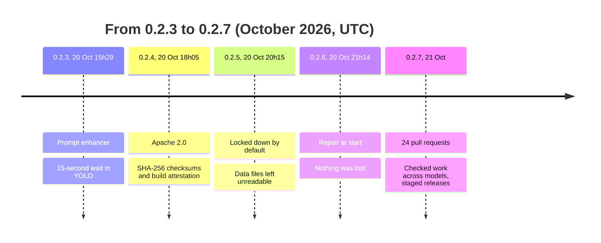
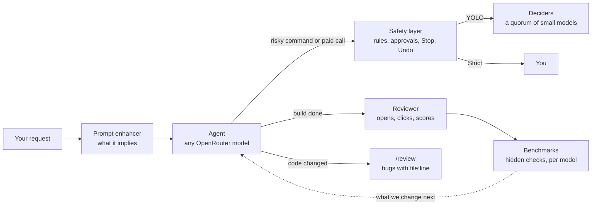
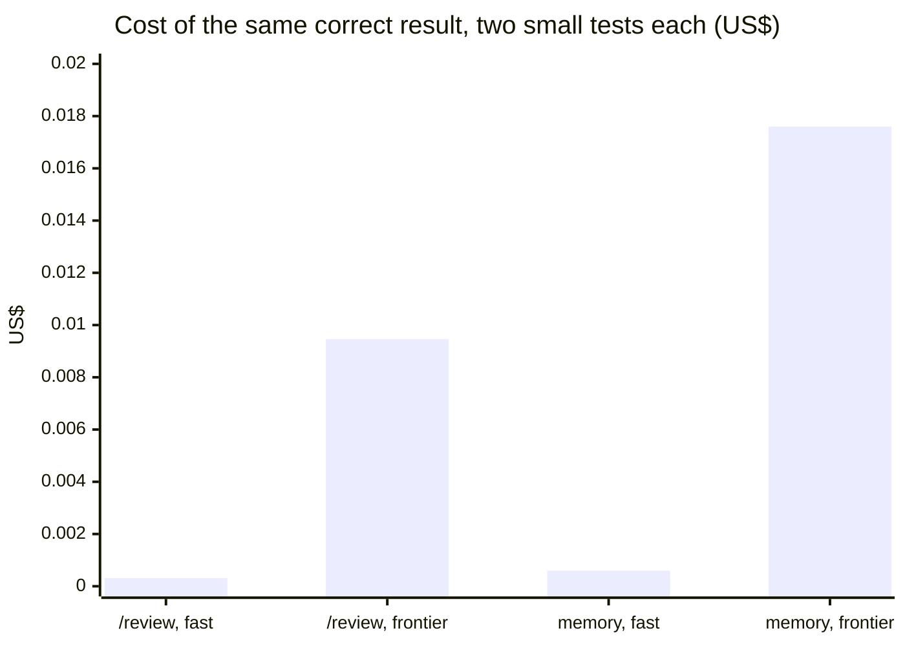
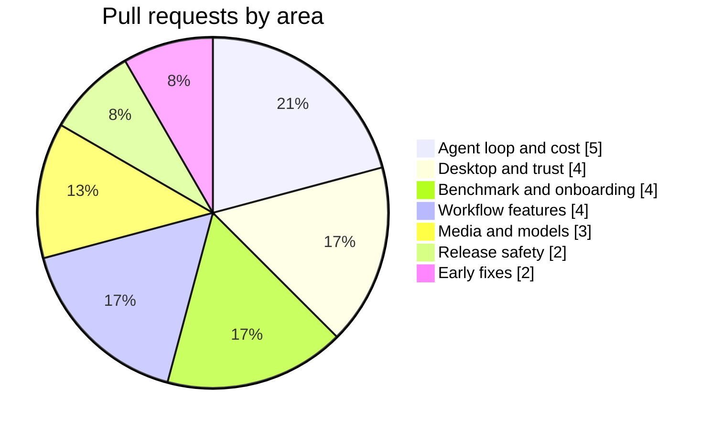

# QuorX 0.2.7: agentic integrity, measured

QuorX is built around one idea: **agentic integrity**. An agent's work should be checked, not trusted. Deciders
vote on what it may do. A reviewer opens and scores what it built. A safety layer guards every command. Benchmarks
tell us whether a change really helped. And because QuorX runs any model on OpenRouter, all of that has to hold for
a frontier model, a cheap fast one, and one that doesn't support tools at all.

QuorX 0.2.7 is 24 pull requests (#35 to #61, not counting #55, held for 0.2.8, and #60, the version bump) on top of
0.2.6. These notes share what we measured and what we learned, the good parts and the bad ones. Every number comes
from a pull request, a release note or a test run. Where we only have one run, we say so.

## Five releases in two days

0.2.5 and 0.2.6 were one hour apart. That hour is the story of [the post-mortem](lockdown-postmortem.md).

## How QuorX checks an agent's work

## The headline numbers

| What | Before | After | Source |
|---|---|---|---|
| Build benchmark tasks passed (one run each) | 1 of 2 | 2 of 2 | #58 |
| Cost per benchmark run | $0.127 | $0.094 (about 26% less) | #58 |
| Benchmark score, sum of five scores out of 25 | 13.5 | 17.0 | #58 |
| Builder input read from the provider's cache | | 92–98% | #42, #58 |
| `delegate` calls in 151 benchmark runs, 8 builder models | 0 | helpers now only in projects of 40+ files | #58 |
| Models with a model card | 0 | 18 | #52 |
| Tests in the full suite, passing | 214 | 271, 0 failing | #40, #61 |

The benchmark comparison is one run of each task per version, so treat the score gap with care. The
[prompt article](cache-friendly-prompt.md) explains why most of it is run-to-run variation.

## Seeing integrity across models

Every model behaves differently, so QuorX now shows its checks per model:

- **Model cards (#52)** give each recommended model its limits, quirks, provider tips and QuorX's own benchmark
  results. The agent reads the cards of the models it uses.
- **Cache-hit share per model (#42)** shows which models really cost less over a long reply.
- **Looks before writing (#58)** shows, per model, how many steps a reply reads before it writes anything.
- **A harder benchmark (#51)** with hidden checks, so scores no longer sit at the ceiling.

The new checks are cheap on cheap models. On the same small tests, a fast model matched a frontier one:

| Check | Fast model (DeepSeek V4.1 Flash) | A frontier model | Same result? |
|---|---|---|---|
| `/review`: 2 planted bugs, then a clean refactor (#37) | $0.00031 | $0.00946 | yes: both bugs, correct lines, no false alarm |
| Memory: propose a fact, then use it (#45) | $0.0006 | $0.0176 | yes: proposed when expected, not when not |

These are two tasks each, so they show that the checks work on a cheap model, not how often.

## What went into 0.2.7

| Area | Pull requests |
|---|---|
| Agent loop and cost | #41 nested projects, #42 cache-hit share, #46 check time-outs, #50 rename retry, #58 smaller prompt |
| Desktop and trust | #49 clear quitting, #53 full terminal in the installer, #57 sign-in per port, #61 this computer only |
| Benchmark and onboarding | #51 harder benchmark, #54 export and import, #56 first-run tour, #59 high-port crash |
| Workflow features | #37 diff review, #38 hooks, #39 scheduled tasks, #45 memory |
| Media and models | #44 production plans, #47 video from a picture and ffmpeg, #52 model cards |
| Release safety | #40 tests on every pull request, #43 pre-releases with Promote and Pull |
| Early fixes | #35 resumed replies, #36 desktop setup and lockfile |

Held back for 0.2.8: #55, the macOS and Linux installers.

## The articles

1. [A smaller, cache-friendly agent prompt](cache-friendly-prompt.md). Cheaper runs, why cache hits matter, and a
   harder benchmark to measure with.
2. [Deciders vs creativity](deciders-vs-creativity.md). Literal checkers turn down what a request only implies. How
   we taught them to read the whole request.
3. [When a security hardening broke the data](lockdown-postmortem.md). An honest post-mortem of 0.2.5.
4. [Shipping safer](shipping-safer.md). Tests on every pull request, staged releases, checksums, and a QuorX that
   answers only the computer it runs on.
5. [Building a release in parallel](parallel-release.md). How the pull requests came together, and where they
   collided.
6. [Four workflow features](workflow-features.md). Diff review, hooks, scheduled tasks and memory, built for
   models of any vendor.
