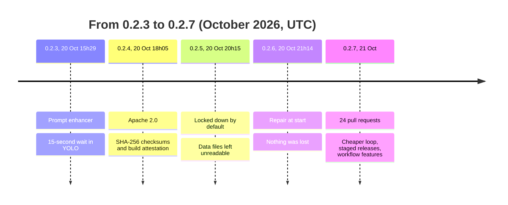
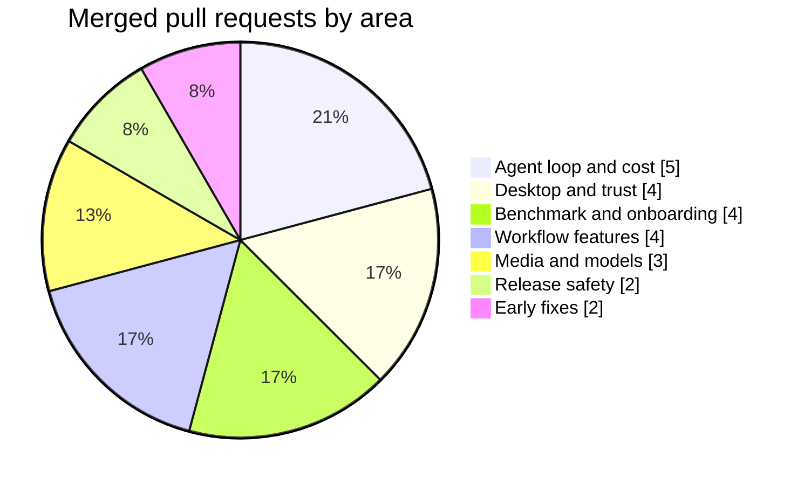

# QuorX 0.2.7: what this release taught us

QuorX 0.2.7 is 24 merged pull requests (#35 to #59, all but #55) on top of 0.2.6. Some make the agent cheaper to
run. Some make releases safer. A few are new workflow features. And one release before it, we broke our own users'
data and had to fix it fast.

These notes share what we measured and what we learned, the good parts and the bad ones. Every number comes from a
pull request, a release note or a test run. Where we only have one run, we say so.

## Four releases in one day

0.2.5 and 0.2.6 were one hour apart. That hour is the story of [the post-mortem](lockdown-postmortem.md).

## The headline numbers

| What | Before | After | Source |
|---|---|---|---|
| Build benchmark tasks passed (one run each) | 1 of 2 | 2 of 2 | #58 |
| Cost per benchmark run | $0.127 | $0.094 (about 26% less) | #58 |
| Benchmark score, sum of five scores out of 25 | 13.5 | 17.0 | #58 |
| Builder input read from the provider's cache | | 92–98% | #42, #58 |
| `delegate` calls in 151 benchmark runs with helpers on | 0 | helpers now only in projects of 40+ files | #58 |
| Tests in the full suite (pass / fail / skipped) | 214 / 0 / 10 | 274 / 0 / 10 | #40, #60 |

The benchmark comparison is one run of each task per version, so treat the score gap with care. The
[prompt article](cache-friendly-prompt.md) explains why most of it is run-to-run variation.

## What went into 0.2.7

| Area | Pull requests |
|---|---|
| Agent loop and cost | #41 nested projects, #42 cache-hit share, #46 check time-outs, #50 rename retry, #58 smaller prompt |
| Desktop and trust | #48 HTTPS pairing, #49 clear quitting, #53 full terminal in the installer, #57 sign-in per port |
| Benchmark and onboarding | #51 harder benchmark, #54 export and import, #56 first-run tour, #59 high-port crash |
| Workflow features | #37 diff review, #38 hooks, #39 scheduled tasks, #45 memory |
| Media and models | #44 production plans, #47 video from a picture and ffmpeg, #52 model cards |
| Release safety | #40 tests on every pull request, #43 pre-releases with Promote and Pull |
| Early fixes | #35 resumed replies, #36 desktop setup and lockfile |

Held back for 0.2.8: #55, the macOS and Linux installers.

## The articles

1. [A smaller, cache-friendly agent prompt](cache-friendly-prompt.md). Cheaper runs, why cache hits matter, and a
   harder benchmark to measure with.
2. [Deciders vs creativity](deciders-vs-creativity.md). Literal checkers turn down what a request only implies. How
   we taught them to read the whole request.
3. [When a security hardening broke the data](lockdown-postmortem.md). An honest post-mortem of 0.2.5.
4. [Shipping safer](shipping-safer.md). Tests on every pull request, staged releases, checksums and HTTPS pairing.
5. [Building a release in parallel](parallel-release.md). How 24 pull requests came together, and where they
   collided.
6. [Four workflow features](workflow-features.md). Diff review, hooks, scheduled tasks and memory, built for
   models of any vendor.
