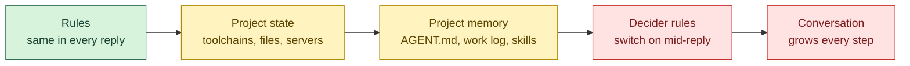
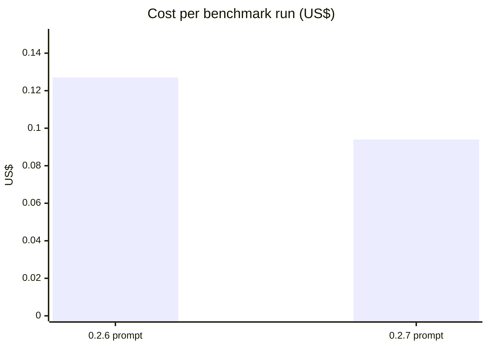

# A smaller, cache-friendly agent prompt

*QuorX 0.2.7 research notes. Pull requests #42, #51 and #58.*

In 0.2.7 the agent's prompt got smaller and was put in a new order. Its stable parts now come first. Helpers are
offered only where they can help. And QuorX now counts how long a reply reads before it writes anything.

On our build benchmark this version passed 2 of 2 tasks for $0.094 a run. The version before passed 1 of 2 for
$0.127. That is about 26% cheaper. But the honest headline is a different one: **the system prompt is about 1% of
what a step costs.** The rest of this note explains why.

## What a step's prompt is made of

We measured the first step of a build and then whole builds, with DeepSeek V4.1 Flash as the builder.

| Part | Size |
|---|---|
| System prompt, first step | about 2.8k–3.4k tokens |
| Tool definitions | about 5.3k–5.5k tokens |
| File list (60 files) | at most about 340 tokens |
| Skills list | about 340 tokens |
| Helper rules plus the `delegate` tool | about 335 tokens |
| Builder prompt per call, over a whole build | 45k–58k tokens |
| Share of it read from the provider's cache | 92–98% |

The prompt grows because the conversation grows: every tool call and every result stays in it. By the middle of a
build, the system prompt is a small slice at the front.

## Why cache hits matter

Providers cache the start of a prompt. When the next call begins with the same tokens, those tokens are read from
the cache, which most providers bill at a fraction of the normal input price. A call is only as cacheable as its
longest unchanged prefix. Change one line near the top, and everything after it is a miss.

So 0.2.7 orders the prompt from the most stable part to the least:

- **Rules first.** They are the same in every reply, so they are cached for every step of every reply.
- **Then the project's state, then its memory.** These are fixed for the length of a reply.
- **The decider rules last.** They switch on in the middle of a reply, so they sit after everything stable.

We also kept something we were tempted to drop. The file list is sent once per reply, as part of that reply's
system prompt. Dropping it after step 1 would save 100–300 tokens a step. But changing the system prompt mid-reply
breaks the cached prefix. At a 92–98% cache share, the miss costs more than those tokens, which are almost all cheap
cache reads anyway. So the list stays, now grouped by folder (`src/{a.js, b.js}`).

Skills are now listed by name. Only skills that share a word with the request keep their one-line description.
That saves about 250 tokens a step.

Before reordering, we compared the whole system prompt on both versions, line by line. Every rule line is the same,
including the rules for untrusted content and commands. Only the skill descriptions and the file list changed shape.

## Seeing the cache, per model (#42)

You can't tune what you can't see. Since #42, the chat's usage view and the cost card at the end of the steps show a
cache-hit share for each model, such as "80% cached". It turns green at 50% or more. A model whose provider doesn't
report caching shows nothing, not a misleading "0% cached". QuorX reads the counts from OpenRouter's usage details,
and also accepts the providers' own field names.

## Helpers only for big projects

QuorX can hand a side task to a helper with the `delegate` tool. We looked at whether builders use it.

- In 151 build-benchmark runs, across 8 builder models, all with helpers on, `delegate` was called **0 times**.
- Helper cost in those runs was **$0**.
- Offering helpers still cost about 335 tokens on every step, plus a nudge after 3 steps of reading that pointed the
  agent at a tool it then didn't use.

So helpers are now offered only in projects with at least 40 files. It's a setting (*Agent loop → Helpers → Only in
projects with at least*), and 0 means always. In big projects, "find every place X is handled" is exactly the job
helpers are built for.

## Counting the slow start

Some models read, search and browse for many steps before they write their first file. That costs money and time,
but until now we couldn't see it. Each reply now records `looksFirst` (steps that only looked before the first write)
and `firstWrite` (the step of that first write). News shows a "Looks before writing" column per model, and the
scorecard shows it too.

We left the plan nudge at 10 steps. No older logs recorded the slow start, and the benchmark builds started writing
within 0–1 steps. There is nothing to tune it on yet. The new column is what will show it.

## A benchmark that can still tell (#51)

Our old build tasks scored 19–20 out of 20. A benchmark at its ceiling can't show whether a change helps. #51 adds
three harder tasks:

| Task | What it tests | Hidden checks |
|---|---|---|
| trip_planner | A three-page site sharing one state file, with settle-up maths and live updates across tabs | 8 |
| fix_budget | An existing app with six planted bugs; the request names only three | 7 |
| py_ledger | A Python command-line tool with CSV edge cases, exit codes and its own tests | 11 |

The builder never sees the hidden checks. The share that pass caps the function score. Each check was tried against
a reference solution (all pass) and against the planted bugs (they fail): fix_budget's seed passes 1 of 7 and a
fixed copy 7 of 7. A new originality score rewards results that are distinct, not just complete. Validating all of
this cost $0.31.

On the harder tasks, fix_budget lands at 14–17 and py_ledger at 11–14, so there is room to measure again.

Building the benchmark also found a real problem. In YOLO, an approval the deciders aren't sure about waits for
you. In a benchmark, nobody answers, so runs sat until the 15-minute limit. The benchmark now declines such a wait
after a minute and counts it as `unanswered`. The same wait can happen in a real chat left alone, which is worth
knowing.

## The measurement

Build benchmark, the first two of the harder tasks from #51, builder DeepSeek V4.1 Flash, one run of each task per version,
run one after the other on a quiet machine.

| | pass | function | craft | design | originality | a11y | sum | $/run | cached |
|---|---|---|---|---|---|---|---|---|---|
| before | 1/2 | 2.5 | 4.0 | 4.0 | 3.0 | 2.5 | 13.5 | $0.127 | 96% / 97% |
| after | 2/2 | 4.0 | 4.0 | 5.0 | 4.0 | 3.0 | 17.0 | $0.094 | 96% / 92% |

The score didn't drop, and that was the goal. We don't claim the change made builds better: with one run each,
most of the gap is variation between runs. The system prompt is about 1% of a call's tokens.

## What we learned

- **The conversation is the cost, not the system prompt.** The lever is what builds up over a reply. The cache share
  shows how much of that is already cheap.
- **Order matters more than size.** Put what never changes first, and don't edit the prefix mid-reply.
- **Measure before you offer a tool.** A tool nobody calls still costs tokens on every step.
- **Keep the benchmark off its ceiling.** Hidden checks and harder tasks keep it honest.
