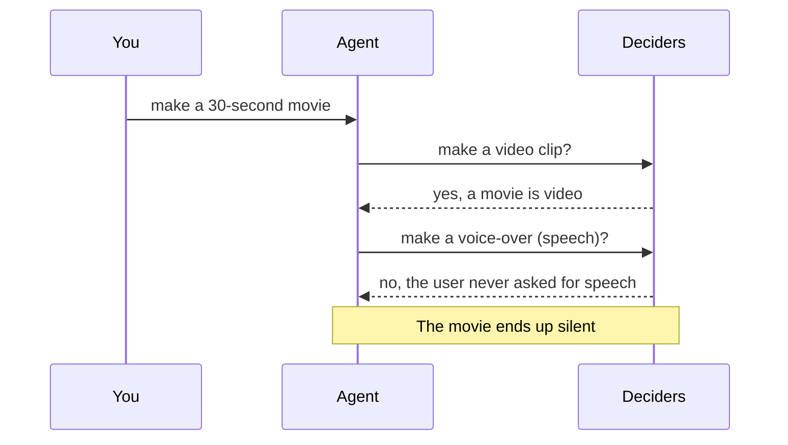
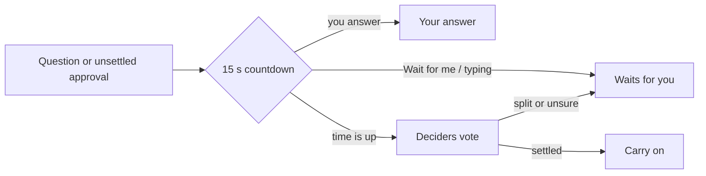

# Deciders vs creativity

*QuorX 0.2.7 research notes. Prompt enhancer and YOLO wait (0.2.3), pull requests #44 and #52.*

In ⚡ YOLO, QuorX doesn't ask you about every paid call or risky command. A quorum of small "decider" models votes
instead. They are deliberately strict. They see only your own messages and facts the harness computed, never the
agent's reasons, because the agent's text is where injected instructions hide.

That strictness has a cost. Literal readers turn down what a request only implies.

## The problem: "make a 30-second movie"

Ask for a 30-second movie, and the agent plans clips, a narration, music and sound. Each paid call then goes to the
deciders with one question: did the user's messages ask for this?

The deciders were right by their rules. The words never mention speech. But most people asking for a movie would
be disappointed by a silent one. The safety rule (judge only the user's words) and the creative need (make what they
obviously meant) pulled in opposite directions.

We didn't want to weaken the judge. Letting it read the agent's plan would bring back the injection risk. So we gave
it a better reading of the user's words instead.

## The prompt enhancer

A cheap model reads your request, and only your request, and spells out what it plainly implies. It answers with
three parts:

| Part | Example for "make a 30-second movie about a cat" |
|---|---|
| goal | A 30-second short movie |
| includes | spoken narration (speech), background music, sound effects |
| assumptions | 16:9 landscape |

Its rule for "implied" is simple: most people asking this would be disappointed without it. It never sees the
agent's text, tool output, files or attachments, so nothing but your words can shape it.

The reading goes three places:

- **to you**, under your message, where you can correct it or drop it;
- **to the agent**, as a note on the request;
- **to the deciders**, beside your own messages, labelled as written by the harness from your words, never by the
  agent.

The deciders' question changed from "did the user ask for this?" to "do the user's messages ask for, or clearly
imply, this?". A movie's voice-over now counts as asked for.

## A person can still steer: the 15-second wait

Some choices are big enough that you might want a say, even in YOLO. So a question or an unsettled approval now waits
15 seconds, with a countdown, before the deciders answer or the reply carries on. *Wait for me*, or typing in the
card, stops the clock. The time is a setting under Budget & approvals.

The wait never approves anything by itself. A split vote still comes to you.

## One plan, not twenty calls (#44)

A trailer needs paid pieces you never name: stills, clips, a voice-over, music. Each call was judged on its own,
so literal deciders still turned down the in-between steps.

Now the agent lists the paid calls up front in a production plan: kind, count, model, seconds per clip, characters
per voice line. QuorX prices it with the same estimates the single-call cards use, and adds the total.

- **🔒 Strict:** one card, a row per kind, and the total. Approve, Always allow or Decline.
- **⚡ YOLO:** the deciders judge the whole plan once. Is it what the request asks for or clearly implies? Is it a
  sensible way to make it? Is the total reasonable? They still never see the agent's reasons, and the clock never
  approves a whole plan.

Matching calls then run without another vote: same kind and model, calls left, and no more than 20% over the planned
price, per call and in total. Anything off the plan or over its estimate is judged on its own. Budgets still apply
first, so a plan over the budget is turned down before anyone is asked.

## Knowing the model's limits (#52)

Creativity also fails in duller ways. The agent picked settings and wrote prompts without knowing a model's limits.
Veo takes only 4, 6 or 8 seconds. Lyria Clip is always 30 seconds. Eleven Flash misreads numbers.

Recommended and default models now carry a model card: limits from the OpenRouter catalogue, quirks seen in QuorX,
prompting tips from each provider's public docs (with the links), and QuorX's own benchmark results. The agent gets
only the cards of the models it is using, at most about 250 tokens each. Tips are dropped first when a card runs
long. Nothing is fetched at run time.

## What we learned

- **Don't loosen the judge; give it a better reading.** The deciders still see only your words and harness facts.
  They just see a fuller version of your words.
- **Show the reading to the person.** An enhancer you can't see or correct would be a hidden policy. Ours sits under
  your message.
- **Approve the plan, not the steps.** One decision with a price is easier for a person and for a quorum.
- **A short wait is cheap insurance.** Fifteen seconds lets you steer the big choices without giving up YOLO.
