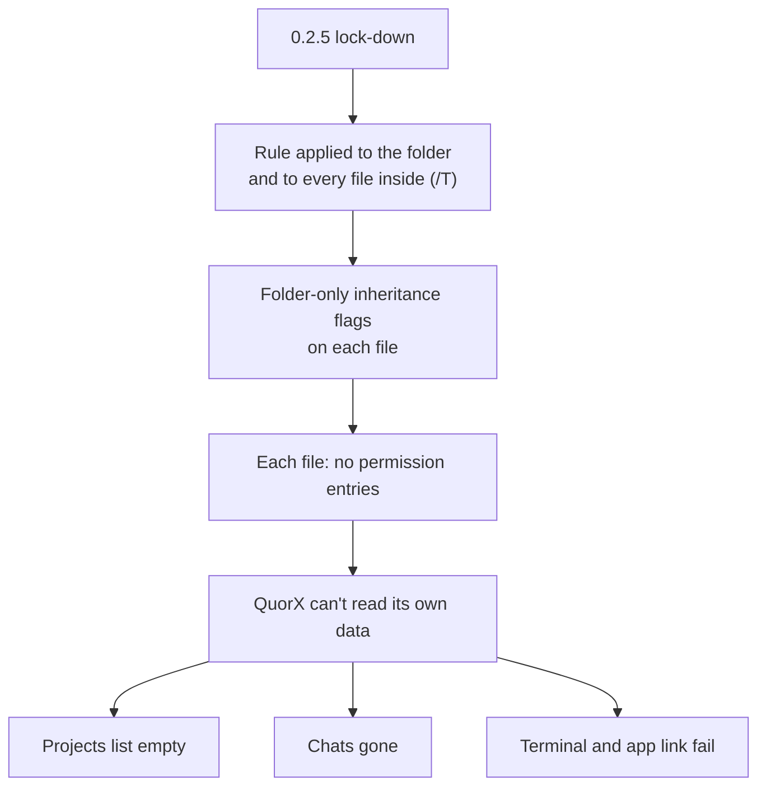
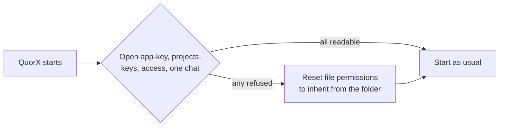

# When a security hardening broke the data

*QuorX 0.2.7 research notes. A post-mortem of 0.2.5 and its fix in 0.2.6 (pull request #34).*

QuorX 0.2.5 was called "Locked down by default". It made QuorX much harder to attack. It also locked QuorX out of its
own data. For about an hour, people who updated saw their projects, chats and terminal seem to vanish. Nothing was
lost, and 0.2.6 repaired it. This is what happened and what we changed.

## What 0.2.5 did

0.2.5 tightened who can reach QuorX and what its commands can read. One part of it locked the data folder on
Windows, so only your account and the system can read it. That folder holds chats, projects, settings and keys.

The rule was meant for the folder. It was applied with `icacls` to every file inside it as well (the `/T` switch),
using inheritance flags that only make sense on a folder. On a file, those flags left no permission entries at all.

## What people saw

- The project list was empty, and chats seemed gone.
- The terminal stopped working.
- The desktop window said its app link was not valid after a restart.

QuorX treated "can't read the file" like "no file yet", so the empty list looked normal. That made it worse: it
looked like data loss, not an error.

The update reached installed apps through auto-update. At the time, a new version went straight to everyone.

## The fix in 0.2.6

0.2.6 shipped one hour after 0.2.5.

- **The lock-down is set on the folder and the `.env` file only.** Files inherit the folder's entries: your account
  and the system.
- **QuorX repairs itself at start, before it reads anything.** It tries to open the files it can't start without
  (`app-key`, `projects.json`, `keys.json`, `access.json`) and one chat. If any of them is refused, it resets the
  permissions on the folder's contents so they inherit again. No administrator rights are needed.
- **It probes several files, not one.** The first version of the repair checked a single file. But a file rewritten
  since 0.2.5 already inherits the right entries, so one readable file doesn't mean the rest are.
- **An unreadable project list says so**, instead of showing an empty list.
- **A test locks a data folder the way 0.2.5 did**, then checks that QuorX repairs it at start and that the new
  lock-down keeps files readable.

## Why our tests missed it

No test locked a data folder and then read it back the way QuorX does at start. A lock-down that is too strict
looks like success from the outside: the files were very private. Nobody could read them, QuorX included.

## What we changed for every release after

- **Every lock-down change needs a "can we still read it?" test** before release. Lock it, then read it back as the
  app would.
- **New versions are staged.** Since #43, a release is first a pre-release that installed apps don't take. It
  reaches them only when it is promoted, and a bad one can be pulled. See [Shipping safer](shipping-safer.md).
- **Upgrades are tested from real old data.** For 0.2.7, the old version itself made a data folder with a project
  and three chats. 0.2.7 then started on that folder. The project list and every chat's messages were byte for byte
  the same.

## What we learned

- **Hardening can be an outage.** A permission change is a data change. Test it like one.
- **"Can't read" is not "empty".** Show the error, so a problem doesn't look like loss.
- **A repair must assume a mix.** After a bad change, some files are fixed and some aren't. Probe more than one.
- **Fast fixes need a slow path too.** We fixed it in an hour, but auto-update had already spread it. Staged
  releases mean the next one can be caught before it spreads.
