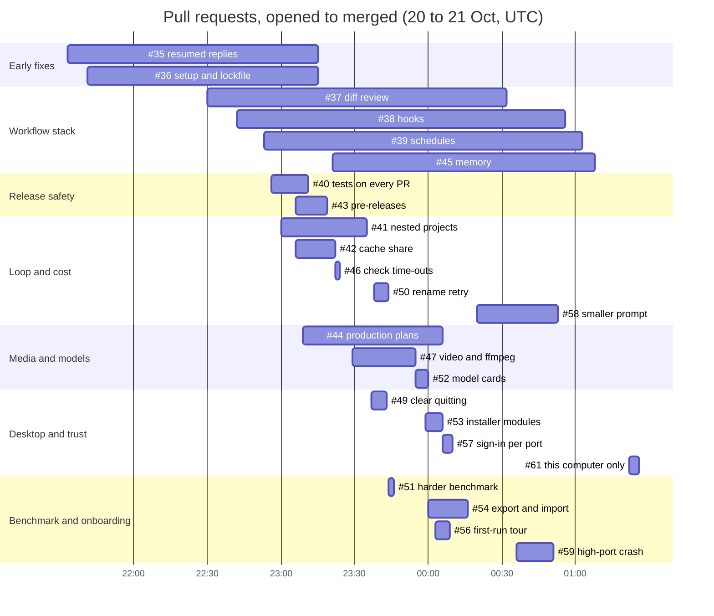
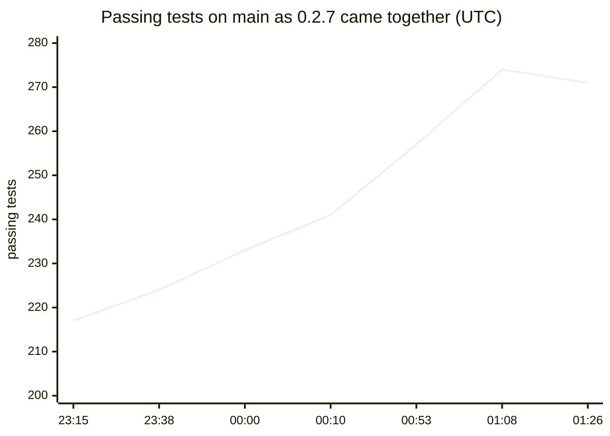

# Building a release in parallel

*QuorX 0.2.7 research notes. How 24 pull requests came together, and where they collided.*

0.2.7 was built in parallel. The work was split into five feature bundles, a stack of four workflow features and two
early fixes, with a merge coordinator who reviewed each pull request, ran the full suite on `main` after merges, and
decided the order. From the first pull request opened to the last feature merged took a little under four hours.

This note is about the process: what made it fast, and what slowed it down.

## The streams

| Stream | Pull requests | Main files |
|---|---|---|
| Release safety | #40, #43 | `.github/workflows/`, `docs/RELEASING.md` |
| Desktop and trust | #49, #53, #57, #61 (#55 held) | `desktop/`, `server/access.js`, `server.js` |
| Media and models | #44, #47, #52 | `server/mediaplan.js`, `server/video.js`, `models/cards/` |
| Loop and cost | #41, #42, #46, #50, #58 | `server/agent.js`, `server/workspace.js`, `server/runs.js` |
| Benchmark and onboarding | #51, #54, #56, #59 | `bench/`, `server/backup.js`, `public/tour.js` |
| Workflow features (stacked) | #37 → #38 → #39 → #45 | `server/codereview.js`, `hooks.js`, `schedules.js`, `memory.js` |
| Early fixes | #35, #36 | `server/runs.js`, `package-lock.json` |

The times before midnight are 20 October. Each bar is a pull request's life on GitHub, not the time it took to
build; most work started before its pull request was opened.

## What worked

- **Bundles that owned their files merged cleanly.** The three media pull requests touched `server/agent.js` too,
  but each kept its edits small and in a different place. They were tried merged together first, and merged in any
  order without a conflict.
- **Tests on every pull request came first.** #40 was one of the first merges, so every later pull request was
  checked on Windows and Linux before it could land.
- **The full suite on `main` after each wave.** The coordinator's checks on `main` grew from 217 passing tests to
  274. #61 then replaced a few tests with one check that other devices are refused: 271 pass, 0 fail.
- **Benchmarks, not opinions, for loop changes.** #58 was reviewed against its numbers and against a line-by-line
  comparison of the prompt's rules.

## What hurt

- **Two pull requests changing `server/agent.js`.** The diff review (#37) and the smaller prompt (#58) both edit the
  agent loop. One had to wait for the other and rebase. The workflow stack made it longer: #38, #39 and #45 were
  built on #37, so each retargeted to `main` after it was squash-merged and had conflicts to settle.
- **A crash found only at integration (#59).** The pages address listens 1000 above the main port. A test server on
  a free port got 64536, so the pages port was 65536, which isn't a port, and the process stopped. It showed up at
  random in CI, blocked the release until fixed, and now has its own test.
- **Previews signing each other out (#57).** Several copies of QuorX on one computer shared one sign-in cookie, so
  opening one signed out the others. That's a real bug for anyone running two copies. Cookie names now carry the
  port.
- **Flaky tests on busy machines.** The `stop:` process-tree tests count processes across the whole computer, and
  a terminal-prompt test and a WinForms test wait on windows. With several test runs on one machine, they sometimes
  failed and then passed alone. We kept them strict and documented them.

## Risky platform work waited

The macOS and Linux installers (#55) were ready to review, but their publish and promote steps had never run end to
end. A release-pipeline change is the kind that breaks everyone at once. So they moved to 0.2.8, where the Windows
build will decide and a failing macOS or Linux job can't block it.

The scope also narrowed at the end. #61 made QuorX answer only the computer it runs on, and took out the earlier work
for other devices. Removing a feature late is cheap when it lives in its own files and has its own tests.

## What we learned

- **Split work by file ownership, not by feature size.** Conflicts come from shared files, not from big features.
- **Stack only when you must.** A stack of four is fast to review and slow to merge.
- **Measure loop changes with benchmarks.** A prompt change can look tidy and still cost more.
- **Keep risky platform work in its own release.** Ship the safe parts now; give the risky part a release where it's
  the only change.
- **Integration finds what unit tests don't.** Random ports, shared cookies and busy machines only show up when many
  things run together.
