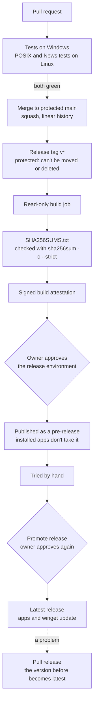

# Shipping safer

*QuorX 0.2.7 research notes. Pull requests #40, #43, #53 and #61, plus the checksums from 0.2.4.*

In 0.2.5, a bad version reached installed apps through auto-update. 0.2.7 puts more steps between a
change and your computer. Each step is small. Together they mean a change is tested, built by a read-only job,
checked, tried as a pre-release, and approved twice before it updates anyone.

## The release pipeline

## Tests on every pull request (#40)

Every pull request, and every push to `main`, runs two jobs:

- **Tests on Windows**: the full suite, the same six suites as on a developer's computer.
- **POSIX and News tests on Linux**: the tests that start real processes on macOS and Linux, which skip on Windows.

Both are required checks on `main`. The workflow needs no secrets, because the tests drive the agent with a scripted
model. Its actions are pinned to commits and it can only read the repository.

The first CI run found two real problems before it was even merged. A debug adapter bridge broke arguments holding
`$` or quotes under `sh` on macOS and Linux. And a test refused the runner's short 8.3 temp path, which contains `~`.
Both were fixed in the same pull request.

## Staged releases with Promote and Pull (#43)

A new version is now published as a **pre-release**. Installed apps read the update feed from GitHub's "latest"
release, and a pre-release is never "latest", so apps keep the version they have.

- **Promote release** checks that the version is a pre-release with all its files, isn't older than the current
  latest, and matches its checksums. Then it makes it the latest release and reads that back. Only then does winget
  get it.
- **Pull release** makes the version before the latest one first, so the update feed moves off the bad version at
  once. Then it marks the bad one as a pre-release with a "Pulled" warning.

Pull says plainly what it can't undo. Apps that already updated stay on the bad version until a newer one ships.

Both run in the `release` environment, so the owner approves each run. They share one queue, so a promote and a pull
never overlap. Release tags are protected by a ruleset: a pushed `v*` tag can't be moved or deleted.

We were honest about one gap. None of these workflows had run when #43 merged: they only run on a tag or by hand.
They were parsed, every `run:` block passed a syntax check, and the checksum step was tried locally. The 0.2.7 tag is
their first real run.

## Checksums and attestation

Since 0.2.4, each release lists the installer's SHA-256 checksum and a signed proof that GitHub built it from this
repository. In 0.2.7, `SHA256SUMS.txt` uses plain LF line endings, so `sha256sum -c SHA256SUMS.txt` works on macOS
and Linux as well as `Get-FileHash` on Windows. The publish job refuses a sums file with Windows line endings.

## This computer only (#61)

The smallest attack surface is the one that isn't there. QuorX's agent runs real commands on your computer, so in
0.2.7 QuorX answers only that computer.

- It listens on 127.0.0.1 only.
- Every request that doesn't come from this computer is refused (403), and there is no way to pair another device.
- The code and settings for other devices are gone, so there is less to guard and less to test.
- Files an older install may still have for other devices stay on the list of secret files the agent can't read.

A test checks that other devices are refused. This keeps QuorX's attention where its work is checked: on the agent,
its commands and its builds.

## A gap the pipeline didn't catch (#53)

While checking installers, we found the desktop app had been shipping without its bundled modules: no full terminal
(node-pty), terminal view or math rendering. The packager drops `node_modules` from a copy of the project root. The
terminal quietly fell back to a plain shell, so it was easy to miss. Each module is now listed on its own, and the fix was
checked by loading node-pty inside the packaged app.

The lesson matches the post-mortem: test the thing people install, not only the source.

## What we learned

- **Put two approvals between a merge and your users.** One to publish, one to promote.
- **Make taking it back one step.** Pull release moves the feed first and explains what it can't undo.
- **Say what wasn't run.** A workflow that only runs on a tag hasn't been tested by a green pull request.
- **Silent fallbacks hide bugs.** A feature that degrades quietly needs a test on the packaged app.
