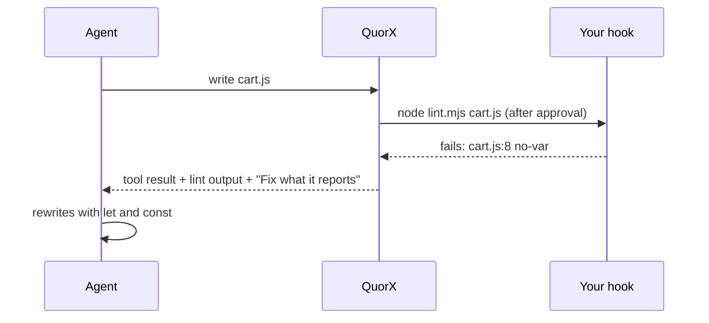

# Four workflow features, for models of any vendor

*QuorX 0.2.7 research notes. Pull requests #37, #38, #39 and #45.*

Diff review, hooks, scheduled tasks and memory are familiar ideas from other coding tools. We built our own versions
with one extra constraint: QuorX runs any model on OpenRouter. A feature has to work with a frontier model, a cheap
fast one, and one that doesn't support tools at all. And the harness, not the prompt, has to enforce the rules.

| Feature | What it is | Cheap model result | Strong model result |
|---|---|---|---|
| `/review` (#37) | Lists bugs in what changed, with `file:line` | both planted bugs, no false alarm, $0.00021 | the same, $0.00604 |
| Hooks (#38) | Commands you pick, run around the agent's writes and commands | lint failure fixed after one question, $0.0049 | |
| Schedules (#39) | Chats QuorX starts on its own | missed run found both TODOs, $0.0011 | |
| Memory (#45) | A short list of facts you approve, in every chat | proposed and used it correctly, $0.0006 for 2 tasks | the same, $0.0176 |

These are small tests with two tasks or one run each. They show the features work on a cheap model, not how well
they work in general.

## Diff review (#37)

`/review` reviews what changed: the last reply's files, uncommitted changes, or the branch against `main`.

- **The harness collects the diff, not the model.** The reviewer gets each changed file's diff with line numbers,
  and the whole file when it's short. It gets no tools. The brief is sized to the reviewer's context window, so small
  models get a smaller one.
- **Findings are checked before you see them.** A finding about a file that didn't change is dropped. A line past
  the end is clamped. Duplicates go, and minor findings are capped at 3.
- **Any model can answer.** Models without tools answer in JSON. A model that refuses a forced tool choice falls back
  to `auto`, and QuorX remembers which ones do.
- **Secrets never reach the reviewer.** Files like `.env` and private keys are never sent. Keys inside code are
  replaced with `[secret removed]`. And git runs with options that stop a project's own config from running programs.

You tick the findings you agree with and send them to the agent to fix in one click.

## Hooks (#38)

A hook is a command you choose, such as "after every file write, run `npm run lint`". The model never decides to run
one and can't change one.

- **Hooks live in QuorX's data folder**, not in the project, so a folder you open can't bring hooks of its own.
- **Every hook command goes through the same rules and approvals** as the agent's own commands. The approval card says
  it's your hook.
- **A file name the agent chose never becomes part of a command line** unless it is a plain path. A name holding
  `;`, `$( )`, quotes or backticks skips the hook, and the steps say why.
- **A failing before-command hook stops that command.** A failing after-write hook sends its output back to fix.

On a cheap model, the hook's lint rule clashed with the request ("use var"). The agent noticed, asked which to follow,
and then rewrote the code.

## Scheduled tasks (#39)

A schedule starts a normal chat on its own: "every weekday at 9, in this project, run this prompt".

- **A missed run runs once.** If the computer slept or QuorX was closed, the run happens once when it's back, labelled
  as missed. Several missed runs become one.
- **Strict waits for you.** Approvals and questions wait as in any chat. A schedule uses YOLO only if you chose YOLO
  for that schedule; saved settings can't switch it.
- **Budgets still apply.** A project at its budget doesn't start, and you get a notice.
- **Two QuorX processes never both start a schedule**, thanks to a lease file.

## Memory (#45)

Memory is a short list of facts and preferences, such as "I use pnpm". Every chat gets it, in every project.

- **A hard size limit: 300 tokens** for the whole list, at most 30 items of 200 characters. With a full memory, the
  system prompt grows by at most about 1,800 characters.
- **The agent can only propose.** One small tool, `remember`, shows a card. It's saved only when you say yes, in YOLO
  too: the deciders never answer it. At most 2 proposals per reply.
- **Never secrets.** Keys, tokens, passwords and card-like numbers are refused, and the error never repeats them.
- **Small models pay only for the facts.** A model without tools, or with under 16k of context, gets the facts but not
  the tool or its rule.

## Design choices that held across all four

- **Enforce in the harness, not in the prompt.** The diff, the hook matching, the schedule clock and the memory limit
  are code. A model can ignore an instruction; it can't ignore code.
- **Assume the model might be small.** Size the brief to the context window, accept JSON from models without tools,
  and gate tools by what QuorX knows about the model.
- **Keep the user's things out of the agent's reach.** Hooks, memory and review cards belong to the user. The agent
  can propose; it can't edit them.
- **Keep the safety path the same.** Hooks and scheduled chats go through the same rules, approvals, budgets and Stop
  as everything else.
