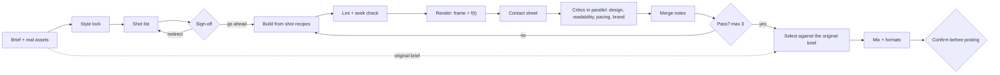

# Video direction: research notes and a scorecard for QuorX

October 2026. This is the research behind the `video-direction` skill. It covers what makes agent-made video look directed, how
QuorX compares with the best public practice, and where the deciders could fit in a video loop.

> **This is an analysis, not a test.** Everything below comes from reading public sources and the QuorX source code.
> QuorX has not run a video benchmark. No testing has been done to prove how the decision models perform on video
> questions. Scores, effort estimates and projected numbers are judgments, and the decider figures in section 5 come
> from logs of mostly text benchmark tasks. Treat every claim about video quality as a hypothesis to test.

## 1. The short version

Well-directed agent video comes from two things working together:

- **Film craft:** a story shape, a shot list, continuity rules, eased motion, cutting for emotion, and a finish for
  muted phones.
- **A harness that** plans the whole film before building it, renders the same frames every time, critiques the real
  frames by topic, and picks the winner against the original brief.

QuorX's build loop already matches or beats most of the harness practices. What it lacks is everything specific to
video: a frame renderer, a timeline, video craft and checks on rendered frames. The new skill covers the craft; the
rest is in the roadmap (section 7).

## 2. The craft

| Area | Rule | Source |
|---|---|---|
| Story | Cold open → introduce → escalate → climax → button. For a product: problem, product, payoff, call to action. | [Neil Oseman](https://neiloseman.com/?p=2173), [MasterClass](https://www.masterclass.com/articles/how-to-make-a-movie-trailer) |
| Hook | Product on screen within 3 s; launch films 15-30 s. | [EveryInc product-launch-video](https://github.com/EveryInc/product-launch-video) |
| Music | Cut to the music; change mood at only 2-3 planned points. | [Neil Oseman](https://neiloseman.com/?p=2173), [PremiumBeat](https://www.premiumbeat.com/blog/3-ingredients-every-great-trailer-needs) |
| Plan | Storyboard first, code second; 6-18 shots, each with purpose, framing, move and cut. | [EveryInc](https://github.com/EveryInc/product-launch-video), [ai-video-storyboard-skill](https://github.com/aicontentskills/ai-video-storyboard-skill) |
| Copy | Real UI text only; invented labels make a video feel fake. | [EveryInc](https://github.com/EveryInc/product-launch-video) |
| Camera | 180° rule (stay on one side of the line), 30° rule between shots of one subject, match on action. | [Adobe](https://www.adobe.com/creativecloud/video/discover/what-is-the-180-degree-rule), [MIT film lexicon](https://shea.mit.edu/ramparts/commentaryguides/glossary/filmlexicon.htm) |
| Motion | Ease-out entering, ease-in leaving, ease-in-out within; never linear. UI moves 200-500 ms, micro-interactions 150-250 ms. Stagger so one element leads. | [madegooddesigns](https://madegooddesigns.com/motion-design-principles/), [75secondes](https://www.75secondes.fr/?p=171782) |
| Editing | Murch's Rule of Six: emotion > story > rhythm > eye-trace > 2-D plane > 3-D space. The 51/23/10/7/5/4 weights are widely cited but could not be checked against the book. | [UT Austin](https://cloud.wikis.utexas.edu/wiki/spaces/rtf318/pages/80022510/Murch+s+Rule+of+Six), [No Film School](https://nofilmschool.com/2016/11/6-rules-good-cutting-according-oscar-winning-editor-walter-murch) |
| Delivery | Text readable at 720p; captions burned in; 1920×1080 30 fps H.264 CRF 18 master; native 9:16 cut; −14 LUFS, −1 dBTP. Platform targets for Instagram and TikTok disagree between sources. | [EveryInc](https://github.com/EveryInc/product-launch-video), [Opus](https://opus.pro/blog/best-loudness-normalizers), [Tella](https://docs.tella.com/help/editing/social-safe-zones) |

## 3. Harness practices

1. **Plan the whole film, then build.** Chained prompts spread early errors ([Google Research](https://research.google/blog/coherent-long-form-video-generation/)).
2. **Sign-off before costly steps** ([OpenMontage](https://pinggy.io/blog/openmontage_agentic_video_production/), EveryInc).
3. **Deterministic, seekable rendering:** preview, critique and final render see the same frames ([HyperFrames](https://github.com/heygen-com/hyperframes), [Remotion](https://www.remotion.dev/docs/ai/skills)).
4. **A router skill with domain skills on demand** (HyperFrames' `/hyperframes`, Remotion's `/remotion-best-practices`).
5. **A shot-recipe library:** tested timing and choreography per shot ([video-shotcraft](https://github.com/Vincentwei1021/video-shotcraft)).
6. **Lock style and references early** (Google's CANVAS memory; [invideo](https://invideo.io/faq/how-do-you-set-up-a-multi-agent-ai-video-production/)).
7. **Lint and check in the loop** (HyperFrames `lint`/`check`/`snapshot`; ffprobe frame checks).
8. **Vision critique with a rubric and a hard limit** ([MindStudio](https://www.mindstudio.ai/blog/what-is-self-qa-loop-ai-agents)).
9. **Critics split by topic, on a different model** (EveryInc's four critics; [VISTA](https://research.google/pubs/vista-towards-test-time-self-improving-video-generation-agent/)'s visual, audio and context critics; [Taskade](https://www.taskade.com/blog/self-improving-ai-agents-reflection)).
10. **Select against the original brief,** not the last version (Google's global selection; VISTA's pairwise tournament).
11. **Editable output as tracks** (video-shotcraft's workbench).
12. **Confirm before posting,** with a dry run (video-shotcraft).

**Research systems.** Google's AI video co-director runs an inner loop (storyboard → keyframes → clips → audio) and
an outer loop where a judge's score feeds a multi-armed bandit that picks the next creative configuration; CANVAS
keeps characters and places stable. VISTA generates candidates, keeps the winner of a pairwise tournament, critiques it
for visual, audio and context fidelity, and rewrites the prompt; its abstract reports up to a 60% pairwise win rate
against baselines and a 68% human preference. Only the VISTA abstract was read; the full paper could not be opened.

## 4. Toolkits compared

| Toolkit | Renders with | Plans first | Review step | Library | Notes |
|---|---|---|---|---|---|
| [Remotion skills](https://github.com/remotion-dev/skills) (official) | Remotion (React) | not stated | not stated | 12 skills, a router | captions skill |
| [HyperFrames](https://github.com/heygen-com/hyperframes) (HeyGen) | HTML in headless Chrome + FFmpeg | beat planning, no gate | lint, check, snapshot | 21 skills, block registry | Apache 2.0 |
| [video-shotcraft](https://github.com/Vincentwei1021/video-shotcraft) | Remotion | storyboard step | ffprobe frame checks, aesthetic rules | 124 shot cards | beat sync, 149 SFX, track workbench |
| [product-launch-video](https://github.com/EveryInc/product-launch-video) (EveryInc) | Remotion scaffold | shot-list table first | 4 parallel critics | scaffold | 15-30 s, product by 0:03 |
| [OpenMontage](https://pinggy.io/blog/openmontage_agentic_video_production/) | Remotion, Python, Piper TTS | treatment first | not stated | 12 pipelines | AGPL-3.0 |
| [ai-video-storyboard-skill](https://github.com/aicontentskills/ai-video-storyboard-skill) | none | 6-18 shot plan | post-production checklist | none | prompts for AI video models |

Read from each project's README or docs in October 2026; counts vary between write-ups. A
[curated list](https://github.com/zhuyansen/awesome-claude-video-skills) of 318 video repos has only 10 focused on
pre-production.

## 5. How QuorX measures up

Points: ahead or matches = 2, partial = 1, missing = 0. "Ahead" means QuorX enforces or measures the practice beyond
what the toolkit READMEs describe. This is a reading of the source code, not a measured result.

| Practice | QuorX today | Status |
|---|---|---|
| Plan the whole film first | `plan` is required first for any build: spec, live to-do list, done-when checks. No shot-list fields yet. | Matches |
| Sign-off before costly steps | Plan first (Go ahead / Stop here / Changes); build tools are refused until Go ahead. | Ahead |
| Deterministic, seekable rendering | No frame renderer yet. `make_video` asks a paid model for a clip of up to 15 s, optionally starting from a picture (first frame), and `edit_video` joins clips, stills, a voice-over and music with ffmpeg. | Partial |
| Router, skills on demand | `use_skill` / `save_skill`; ten video skills since October 2026 (section 8). | Matches |
| Shot-recipe library | None. | Missing |
| Lock style and references early | `DESIGN.md` + `tokens.css`, design lint, brand score, `extract_design`. Nothing for characters or locations. | Matches |
| Lint and check in the loop | `node --check`, `ast.parse`, HTML link checks; nothing for rendered video. | Partial |
| Vision critique, rubric, hard limit | A separate reviewer plays the build, scores five topics against a bar, 1 send-back by default (3 at most); verdicts logged and compared with a judge. Reviews pages, not frames. | Ahead |
| Critics split by topic, other model | One reviewer scores every topic, from another model family. | Partial |
| Select against the original brief | The reviewer tests against the request and plan; the enhancer's reading reaches the judges. One candidate only. | Partial |
| Editable output as tracks | `edit_video` keeps its filter graph in `.quorx/edits/`, and Undo covers the finished file; no timeline editor. | Partial |
| Confirm before posting | Paid media and risky commands need approval: the person, or in YOLO a quorum of deciders that never includes the chat's own model. | Ahead |
| Video craft knowledge | The video skill family (section 8). Written, not yet tested on video. | Covered in writing |

**Score:** 58% overall (15 of 26 points), 83% for the nine loop and safety practices, 0% for the four video-stack
practices, before any video skill existed.

## 6. Where the deciders fit

The deciders (`typesafe/jev-1.14`, `liquid/d1-ultra`, `openai/gpt-6-luna-decisions` by default) answer typed
questions (yes/no, choice, score) with probabilities. QuorX averages the votes, shuffles choice options per decider, and
computes confidence per type (|2P−1| for yes/no, the top share above chance for a choice, the spread around the top
level for a score): settled at 0.8 or more, lean at 0.5. Image questions go to one look decider (luna by default), and
the others join when it is unsure.

| Moment | Question | Input | In QuorX? |
|---|---|---|---|
| Brief | "The message says how long the film is / where it will be posted / whether it needs a voice." | text, yes/no | gap check exists; video fields are new |
| Shot list | "Every shot states a purpose and its cut out." "The product is on screen before 0:03." | text, yes/no | new |
| Style lock | A reference picture's background, accent, type and density. | image, choice | exists (`extract_design`) |
| Frames | "The caption in this frame is readable." "Nothing sits under the right-hand rail." "A is on the left in both shots." | image, yes/no | new (the skill uses `look` for this) |
| Critique | One score question per topic: design, readability, pacing, brand. | image, score | new |
| Select | "Which of these two sheets better fits what the person asked: '…'?" | image, choice | new |
| Spend + post | The approval judge for paid media. | text, yes/no | exists |

**What the logs show.** These numbers come from the maintainer's local QuorX logs and are almost all **text
benchmark questions, not video**. They describe the deciders in general and prove nothing about video checks.

| Decider | Median per vote | Cost per 1,000 votes | Votes |
|---|---|---|---|
| typesafe/jev-1.14 | 493 ms | $0.108 | 126 |
| openai/gpt-6-luna-decisions | 622 ms | $0.131 | 224 |
| perplexity/pplx-decider-v1.2 | 787 ms | $0.022 | 11 |
| liquid/d1-ultra | 912 ms | $0.057 | 126 |

Of 868 logged questions, 68% settled, 15% leaned and 17% stayed uncertain; all deciders agreed with the pick 82% of
the time. Against the builder's committed guess, 72% were questions it already knew (theatre) and 49 changed its
answer. The lesson for video: ask about what the builder can't judge from its own code (legibility, safe zones,
screen direction), measure what can be measured, and don't ask taste questions, where `decide-well` already records
the deciders as least sure. Whether topic critics as score questions work at all is untested; design and pacing
scores may turn out to be taste questions.

## 7. Roadmap

| Stage | Change | Closes |
|---|---|---|
| Now | The video skill family (section 8) | video craft |
| Now | Topic critics: the reviewer as 3-4 parallel critics with their own rubrics, on decider models | split critics |
| Now | ffprobe and a seek test in the write checks | lint in the loop |
| Next | A shot-recipe library, one card and one runnable demo per shot | shot library |
| Next | Two or three candidate cuts picked by tournament against the person's words | select vs. brief |
| Later | A render tool: seek each frame in the headless browser, encode with ffmpeg, as a background job | deterministic render |
| Later | A timeline manifest and editor for shots, captions and sound | editable tracks |

Projected score if each stage lands as described: 73% after Now, 85% after Next, 100% after Later (video stack 25%,
50%, 100%). These are arithmetic on the table above, not measurements. The first real test should be a small video
set in `scripts/bench.mjs --set build`, judged by a person, with and without the skill and the decider checks.

## 8. Update, 23 October 2026: one skill became ten

A public list of eight video, 3-D and three.js repositories pointed to two projects that go further than the toolkits in
section 4: [lemo-opuscar](https://github.com/lemomo-ai/lemo-opuscar) (59 film styles made only in code, with a directing
guide and a technique guide, MIT) and [mg-styles-15](https://github.com/Vincentwei1021/mg-styles-15) (15 motion-design
films with their prompts, a review rubric and a prompt template, MIT). [img2threejs](https://github.com/img2threejs/img2threejs)
(Apache-2.0) rebuilds a reference object as three.js code pass by pass. The other five (video-shotcraft,
dsh-blender-plugin, dioramas, Motion2MixamoRig, and jianying-headless, which is no longer public) add less for QuorX today.

What they add beyond the earlier research:

- **A page contract** for code films: `DUR`, `render(t)`, `READY`, timed sound events `EV` and on-screen text `TEXTS(t)`.
- **One timeline** drives picture, score, effects, subtitles and checks; cue timing is measured, aiming for 0 ms.
- **Reading time as arithmetic:** text holds letters ÷ 15 + 1.5 s; subtitles at least 1.8 s and the spoken line + 0.6 s;
  title cards at least 4 s.
- **A fuller treatment:** three candidate structures, a benchmark with what to learn and what not to take, a shot list
  with the reason for each shot, a beat sheet, a cue map and a sound design table.
- **Sound as half the film:** three layers, two real silences, J and L cuts, original scores from free sample libraries,
  and voice checked by transcribing it back.
- **Styles as reusable packs** with traits sorted into safe to change, changes its character, and can't change, and
  signature features written as checkable numbers.
- **An anchored 1-10 jury rubric** (5 = student work, 8 = agency work), which makes design and pacing scores less of a
  taste question for the deciders.

There is also more than one way to make a video: drawn in code, built from still images, made from AI-generated clips,
cut from real footage, or a mix. The skills cover each route and the craft they share:

| Skill | Covers |
|---|---|
| `video-direction` | The hub: picks the route; the brief, treatment, story, camera and motion rules; delivery |
| `film-render` | The code route: the page contract, preview, frame capture in a headless browser, ffmpeg encoding |
| `film-from-images` | Stills (the user's or `imagine`) with camera moves and parallax |
| `film-from-ai-clips` | `make_video` shots: a spend plan, a look line, `start_image` for a consistent cast, choosing takes, joining |
| `film-from-footage` | Real recordings: a transcript-led paper edit, b-roll, captions, an EDL or OpenTimelineIO hand-over |
| `motion-graphics` | 5-15 s design-led pieces from a four-part brief with checkable signature features |
| `three-from-image` | 3-D props and characters in three.js code, compared with the reference after every pass |
| `film-style` | Use, adapt or create a reusable STYLE.md, proven with a style frame and a short demo |
| `film-sound` | Ambience, foley, score, voice with a speech-to-text check, ducking, the -14 LUFS master |
| `film-review` | Contact sheets, measured checks, look checks, the anchored rubric and fix rounds |

Two roadmap items look cheaper than section 7 says. QuorX already drives Edge and Chrome on Windows, so a render tool
can capture frames natively instead of through WSL. And editable tracks can start as an EDL or OpenTimelineIO export
the user opens in their own editor, instead of a timeline editor inside QuorX.

**Still analysis only.** None of these skills has been run on a real video task in QuorX, and the projects they borrow
from tune their styles for one frontier model, so results with QuorX's cheaper default models may differ.

## 9. Video Mode

Runs of a film request showed the agent planning before asking, using none of the video skills, and spending before
anyone saw a shot. Video Mode (`server/videomode.js`, ⚙ Settings → Video) changes that for films only:

1. **Is it a film?** The prompt enhancer now says what is being made (`kind`). `video` turns Video Mode on, and any other
   kind keeps it off, even when the words say "video" (a video player is an app). With no reading, plain words decide
   ("make me a video of…", not "add a video player"). The chat remembers it, and a chip under the message says
   **Not a video** to turn it off.
2. **Skills, loaded by the harness:** `video-direction`, `film-sound` and `film-review` go into the reply; the agent loads the
   route skill once the brief picks the route.
3. **Brief, then story:** one `ask_user` card on length and shapes, route, the user's material and real people (allowed),
   and sound, then three story structures. A film reply may ask up to 8 questions (the usual limit is 4). In ⚡ YOLO
   the cards still appear and wait (120 s by default), then the agent's recommendations stand; the deciders don't guess.
4. **Storyboard gate:** the `storyboard` tool draws 6-9 shots in the pane and waits for Go ahead or changes. Paid pictures,
   clips, music and voice (and `media_plan`) are refused until it is approved; YOLO goes ahead after the wait.
5. **Film checks for the reviewer:** each new film is measured (length, size, fps, sound, loudness, true black frames)
   and tiled on a contact sheet, so the reviewer scores the film and not only the page that plays it.

A request that is not a film gets the same prompt, tools and question limit as before; a test compares the two.

## 10. Video Mode v2: music first, moving pictures

The first real films (a 30 s Mumbai monsoon film and a 58 s cricket film) showed four problems:
- **Music:** every score written in code rumbled. The sound below 150 Hz was 4-4.5 dB louder than everything above it: filtered-noise "rain" and "crowd" beds swelling under the music, which the -14 LUFS master then turned up.
- **Cuts:** shots of a fixed 4 s ran at 6.4 beats each, so only 1 of 5 cuts landed on a beat.
- **Motion:** stills with a 9% zoom over 4 s read as a slideshow.
- **Viewer page:** 13-37% of the agent's tool calls went to a page around the film.

What changed:
1. **Music first.** The brief recommends a music model (Lyria 3 Clip, about $0.04 for 30 s) when music is on. Measured through OpenRouter: Pro ignores the length asked (35 s asked, 60 s made) but keeps the sections in order; Clip makes 28-30 s; the same seed gives a different take. So the film fits the music:
   - `music_map` finds the tempo (checked against the tempo asked for), the bar lines, the changes and whether the track ends cleanly;
   - `fit_music` trims from the front on a bar line, keeping the real ending, or plays whole bars from the middle again with 25 ms crossfades on the downbeat. A 28 s clip made 35 s this way sounded seamless when listened to.
2. **Moving pictures.** With video clips on, the brief recommends turning each still into a clip with `make_video` from that still (about $1 for 30 s at 720p), so the shots move and stay consistent. It also offers a mixed route (key shots move) and plain stills.
3. **The film is the deliverable.** It opens in the Browser tab; a viewer page only when asked (⚙ Video → Viewer page). The reviewer now opens the film itself, not the storyboard sheet.
4. **More film checks:**
   - the bass against the rest;
   - the tempo, and how many cuts land within 2 frames of a beat;
   - whether the sound ends or just stops.
   Films are found by when they were written, since the undo checkpoint leaves out big files, so a 25 MB film is now measured.
5. **Fixes from the same runs:**
   - A reply that ticks off its whole plan on its last step is reviewed, not called "out of steps".
   - A command that edits a file in place (`(Get-Content f) -replace … | Set-Content f`, `sed -i`) is steered to `edit_file` instead of going to the approval vote, which had turned two of them down as unasked.
   - A chat continued from a film chat (✦ Fresh chat) keeps Video Mode and the storyboard approved there.

## Sources

Skills and toolkits: [EveryInc product-launch-video](https://github.com/EveryInc/product-launch-video) ·
[video-shotcraft](https://github.com/Vincentwei1021/video-shotcraft) ·
[ai-video-storyboard-skill](https://github.com/aicontentskills/ai-video-storyboard-skill) ·
[Remotion agent skills](https://www.remotion.dev/docs/ai/skills) · [HyperFrames](https://github.com/heygen-com/hyperframes) ·
[OpenMontage overview](https://pinggy.io/blog/openmontage_agentic_video_production/) ·
[curated video skills list](https://github.com/zhuyansen/awesome-claude-video-skills).

Research: [Google Research: coherent long-form video](https://research.google/blog/coherent-long-form-video-generation/) ·
[VISTA](https://research.google/pubs/vista-towards-test-time-self-improving-video-generation-agent/) ·
[MVAgent](https://arxiv.org/html/2609.30609) · [MovieAgent](https://github.com/showlab/MovieAgent) ·
[Self-QA loop](https://www.mindstudio.ai/blog/what-is-self-qa-loop-ai-agents) ·
[Reflection loops](https://www.taskade.com/blog/self-improving-ai-agents-reflection) ·
[invideo multi-agent FAQ](https://invideo.io/faq/how-do-you-set-up-a-multi-agent-ai-video-production/).

Craft and delivery: [Murch's Rule of Six](https://cloud.wikis.utexas.edu/wiki/spaces/rtf318/pages/80022510/Murch+s+Rule+of+Six) ·
[Adobe: 180-degree rule](https://www.adobe.com/creativecloud/video/discover/what-is-the-180-degree-rule) ·
[MIT film lexicon](https://shea.mit.edu/ramparts/commentaryguides/glossary/filmlexicon.htm) ·
[Neil Oseman: trailer tips](https://neiloseman.com/?p=2173) ·
[Motion design principles](https://madegooddesigns.com/motion-design-principles/) ·
[Opus: loudness](https://opus.pro/blog/best-loudness-normalizers) ·
[Tella: safe zones](https://docs.tella.com/help/editing/social-safe-zones) ·
[Reap: safe zones](https://reap.video/blog/short-form-video-safe-zones).
