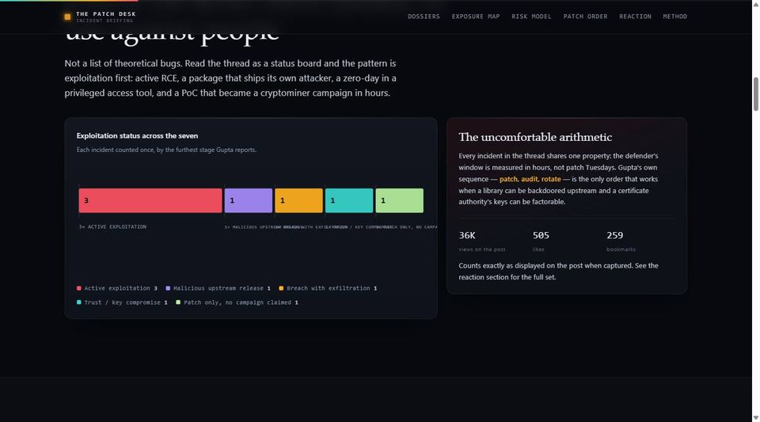

QuorX checks its own work by looking at it. After it builds a page, the agent opens it, scrolls, clicks, and asks
vision judges yes-or-no questions about each screenshot: "is the chart drawn?", "is the menu visible?". When the
screenshot is wrong, everything built on it goes wrong too.

This is the story of a bug that made every screenshot below the top of a page come back empty, how a user's chat
showed it, and how it was fixed.

## What the user saw

A user installed QuorX from the Microsoft Store and asked for a detailed news report with charts, figures and
diagrams. The agent planned it, wrote it, and opened it. On their screen the report looked finished: a hero, incident
cards, an exploitation chart, an exposure map. They told the agent so, mid-reply: "I can see the site, it looks neat,
all good."

The agent kept going. It reloaded the page with `?v=7`, then `?v=9`, `?v=11`, `?v=13`. It wrote a temporary debug
probe into the app's code. It read the stylesheet line by line looking for something hiding the content. The user
shared the chat and asked a simple question: it feels like it's stuck in a loop, why can't it see the page?

## What the chat's log showed

Every QuorX reply keeps a log of each step: every tool call, its result, and every screenshot the agent saw. Reading
it, the pattern was plain.

```timeline
{ "items": [
  { "when": "27:07", "title": "Opens the report", "text": "The screenshot of the top of the page is fine: the hero headline, the menu, the buttons.", "tag": "ok" },
  { "when": "27:13", "title": "Scrolls 1000 px", "text": "The screenshot is the page's background colour, nothing else. Not even the sticky menu bar.", "tag": "blank" },
  { "when": "27:18", "title": "Asks: is the chart drawn?", "text": "The judges see an empty screen and answer no. The agent starts looking for a bug in its chart code.", "tag": "blank" },
  { "when": "29:15", "title": "Reloads with ?v=7, ?v=9, ?v=11…", "text": "Every screenshot after a scroll or a click comes back the same: background only.", "tag": "loop" },
  { "when": "29:40", "title": "Writes a debug probe into the page", "text": "The probe proves the sections exist and have the right sizes. The screenshots still show nothing.", "tag": "loop" },
  { "when": "30:52", "title": "The user says it looks good", "text": "The agent reads it, but its own checks keep failing, so it keeps polishing.", "tag": "loop" }
] }
```

Eleven of the agent's screenshots after a scroll or a click had exactly the same average brightness, 9 out of 255:
the report's background colour, `#07090d`, and nothing on it.


## Ruling things out

A page that is blank only for the agent can have several causes, so each one was checked against the same report.

| Suspect | What was checked | Verdict |
|---|---|---|
| The page hides content until it scrolls into view | Many pages fade sections in, but even the sticky menu bar, which never fades, was missing | Ruled out |
| The headless browser draws it wrong | QuorX's headless browser opened a copy of the report, scrolled 1600 px, and screenshotted the chart and cards perfectly | Ruled out |
| The desktop tab doesn't paint while hidden | The agent's tab sits behind the Browser pane, but a hidden view in a plain Electron test still screenshotted fine | Ruled out |
| The screenshot is taken from the wrong place | The desktop app captured the page from the top-left of the document, not where it was scrolled to | **The cause** |

## The cause

In the desktop and Store app, the agent's browser tab is a real Chromium page shown inside the Browser pane. When the
pane is narrower than the page, QuorX shows the page scaled down to fit, and takes screenshots at the page's own size by
passing Chromium a clip: a rectangle to capture.

That rectangle always started at `0, 0`. A clip is measured in page coordinates, from the top of the document, not from
the top of the window. Once the page had scrolled to 1600 px, the area at `0, 0` was off screen, and Chromium returned
what it had there: the background colour.

```compare
{ "prompt": "Screenshot the page after scrolling 1600 px down", "options": [
  { "label": "Before (0.2.10)", "steps": [
    { "title": "Clip starts at 0, 0", "text": "the top of the document" },
    { "title": "That area is off screen", "text": "the window shows 1600–2400 px", "bad": true },
    { "title": "Chromium returns background", "text": "brightness 9 of 255, nothing drawn", "bad": true }
  ], "verdict": { "title": "The agent sees an empty page", "text": "Every check after a scroll fails, so it reloads and probes a page that is fine." } },
  { "label": "After (0.2.11)", "steps": [
    { "title": "Ask where the page is scrolled to", "text": "Page.getLayoutMetrics: 0, 1600" },
    { "title": "Clip starts there", "text": "the part the window shows" },
    { "title": "Chromium returns the page", "text": "the chart, the cards, the menu" }
  ], "verdict": { "title": "The agent sees what the user sees", "text": "Its checks pass on a page that works, and fail only on one that doesn't." } }
] }
```

The test that settled it ran the user's own report in Electron, scaled and scrolled exactly as the desktop app does.
A clip at `0, 0` gave the same blank image the agent got, at the same brightness. A clip at the scrolled position gave
the page:



The headless browser was never affected: it takes screenshots without a clip. That is why QuorX's own tests, which use
the headless browser, never caught it.

## What changed in 0.2.11

```stat
{ "items": [
  { "label": "Blank screenshots after a scroll, in that chat", "from": 11, "to": 0 }
] }
```

- The desktop app asks Chromium where the page is scrolled to (`Page.getLayoutMetrics`) and starts the clip there.
- Nothing changes for the headless browser, or for a page shown at full size.

```callout
{ "tone": "good", "title": "What we learned", "text": "When an agent loops, look at what it was shown before what it did. Here the agent wasn't confused: it was answering honestly about an empty screenshot. The log of every screenshot it saw, kept with the chat, made a six-minute loop a ten-minute fix." }
```

```callout
{ "tone": "info", "title": "Share a chat that goes wrong", "text": "A chat where QuorX loops, stalls or misreads a page is the most useful bug report there is. Open an issue on GitHub with what you asked and what happened; the chat's steps show the rest." }
```
