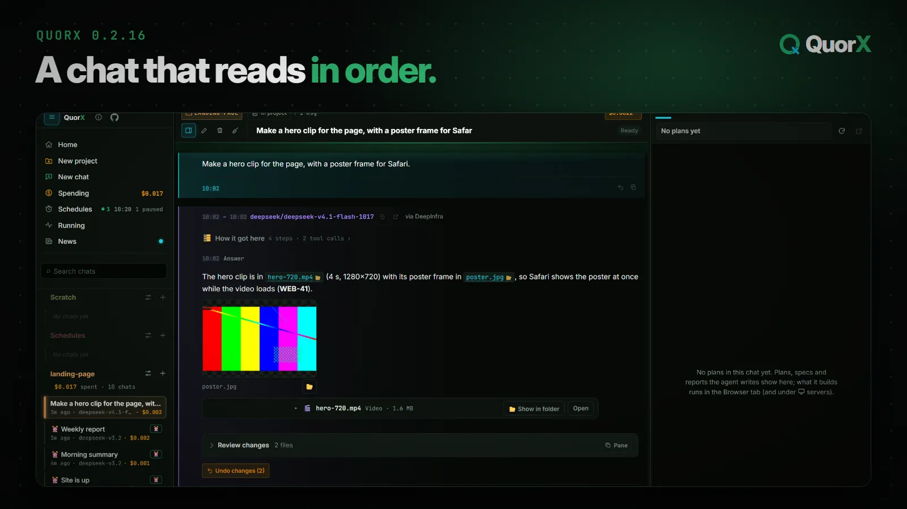
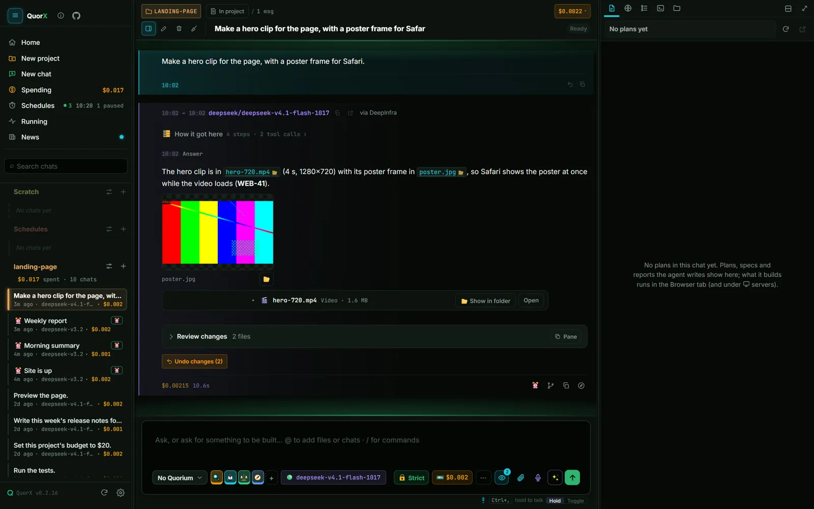
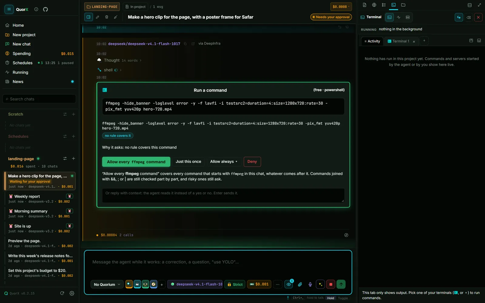
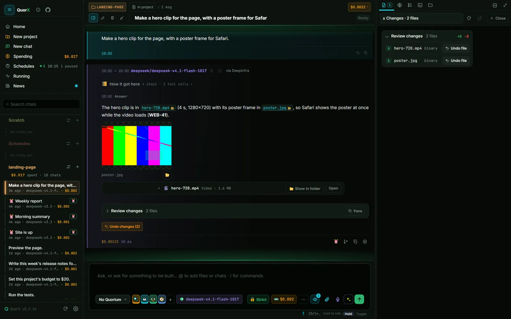
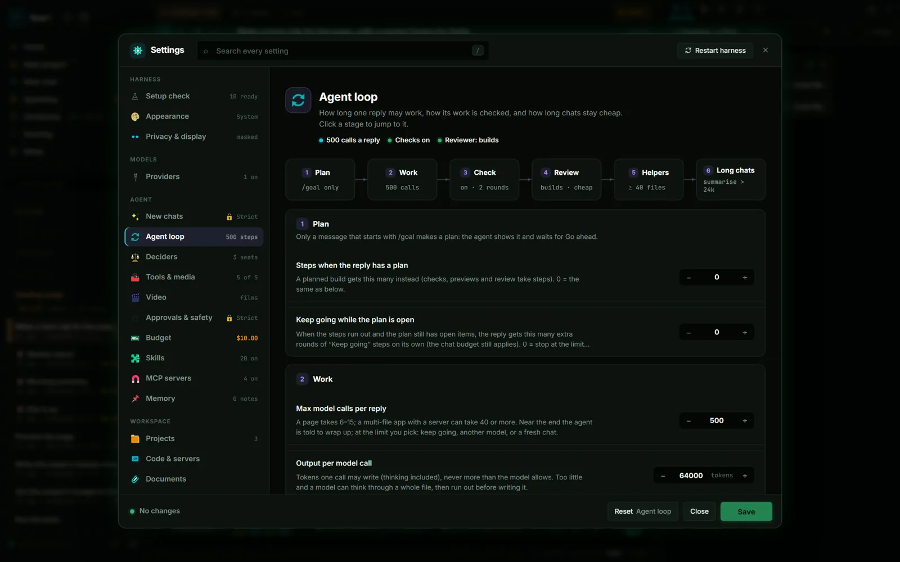

0.2.16 is about reading a chat. Until now a reply was one fixed block: the work on top, the answer under it, and
anything that happened after the answer (a re-check, the reviewer, a note you sent) squeezed in above it. Now the
chat reads like a log: top to bottom, in the order it happened, with a time on every message.

```stat
{ "items": [
  { "label": "Changes in 0.2.16", "from": 0, "to": 32 },
  { "label": "Agent-loop upgrades", "from": 0, "to": 9 },
  { "label": "Budgets per chat", "from": 4, "to": 1 }
] }
```

## The chat, in order



- **No bubbles.** Every message is a full-width row with a glowing edge: yours teal on the right, the agent's violet
  on the left. The agent's edge turns green, amber or red with its state, so you can tell at a glance whether it's
  working, waiting for you or stopped.
- **Times everywhere.** Each reply shows when it started and ended ("10:02 – 10:02"), the answer shows when it was
  written, and step times sit on their own line, only when the minute changes.
- **The answer first.** A finished reply folds its work into **How it got here**. Open it to see every step; leave it
  shut and the answer is what you read.
- **Work after the answer goes under it.** A re-check, the reviewer or a note you sent shows below, in order.
- **One row, one layout.** Stats on the left, buttons on the right, always in the same order.

## One yes per program

Approving a command used to cover that exact line. In 0.2.16, a yes covers the program.



Say yes to one `ffmpeg` command and every later `ffmpeg` command in that chat runs without a card, whatever its
arguments. **Just this once** still runs only the one line, and **Allow always ▾** saves the rule for the project or
everywhere. Commands joined with `&&`, `;` or `|` are still checked part by part, and risky ones still ask.

```compare
{ "prompt": "Making a video clip and its poster frame, in Strict",
  "options": [
    { "label": "0.2.15", "steps": [
      { "title": "ffmpeg … hero-720.mp4", "text": "A card: allow this exact command." },
      { "title": "ffmpeg … poster.jpg", "text": "Another card: the arguments changed.", "bad": true }
    ], "verdict": { "title": "Two cards", "text": "One for each line, even though it's the same program." } },
    { "label": "0.2.16", "steps": [
      { "title": "ffmpeg … hero-720.mp4", "text": "A card: Allow every ffmpeg command." },
      { "title": "ffmpeg … poster.jpg", "text": "Runs: the ffmpeg rule covers it." }
    ], "verdict": { "title": "One card", "text": "Saved as the rule ffmpeg * for this chat, matched by whole word." } }
  ] }
```

Always allow is now on every command card, except two: reading key files, and deleting or moving files outside the
project.

## One budget per chat

The reply, media and daily caps and the project budgets are gone. A chat has one budget, shown in the message box,
and that's the one number to watch. `/goal` is now the one way to ask for a plan, and the prompt enhancer asks before
it rewrites your message.

## Files beside the chat



Files, reviewer rounds, the live plan, **Review changes**, long answers, a command's full output and code review
findings open in the side pane's Artifact tab, under "From the chat". **Compare** splits the pane to show two side by
side. Pictures and videos in a chat have **Show in folder**, videos in project files can be scrubbed, and the file
viewer has **Show in folder** next to Copy path.

## A smarter agent loop



Most of this release's work is under the hood, in **⚙ Settings → Agent loop** and **Memory**:

| Upgrade | What it does |
|---|---|
| **Protect files that changed** | If you change a file the agent read, it reads it again before editing it, so it never writes over your work. |
| **Background-job notices** | A job that ends while the agent works is reported with its exit code and last lines, so it stops checking. |
| **Other tools' notes** | AGENTS.md, CLAUDE.md, GEMINI.md, .cursorrules and Copilot instructions are read with AGENT.md. |
| **Tools when needed** | Rare tools (Android, the debugger, video editing…) load only when asked for, so each step sends less. |
| **Hooks around anything** | Before a write, around any tool, and at the start and end of a reply. A failing end hook sends the reply back. |
| **Helper roles** | Explore, Test and Draft, each with its own model and steps. Edit them, or add your own. |
| **Typed memory** | Notes have a type, a why, details read only when relevant, and a scope: one project or all. |
| **Unchecked work** | A reply that did work says what wasn't checked: a job still running, checks turned off, a reviewer that didn't run. |

The agent can read and change every one of these settings with you from a chat, and **Reset** puts them back.

## Also in 0.2.16

- Two built-in skills, **motion design** and **HyperFrames films**, for videos with exact easing and timing.
- Browser tabs belong to their project, so a chat never shows another project's site.
- Every server in the Servers panel can be edited and deleted.
- Closing a terminal no longer leaves an empty Terminal window behind.
- 💬 Comment mode in the desktop app uses your real browser tab, so search sites don't show a bot check.
- Approval cards left open by a restart close instead of doing nothing.

## Get it

0.2.16 is out as the installer and from source. An installed QuorX updates itself; the Microsoft Store copy gets it
with a later Store release. All 32 changes are in [What's new](https://quorx.genxmims.org/news/), and the download is
on [the home page](https://quorx.genxmims.org/#get).
