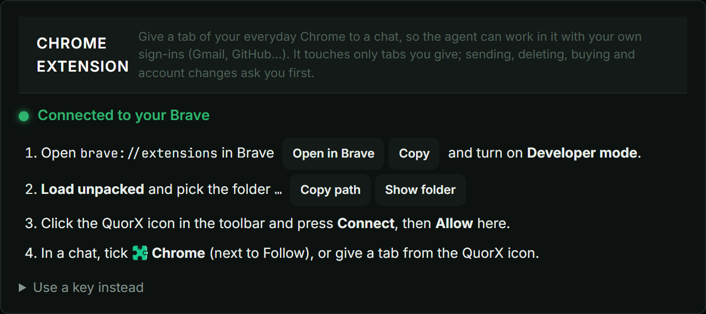
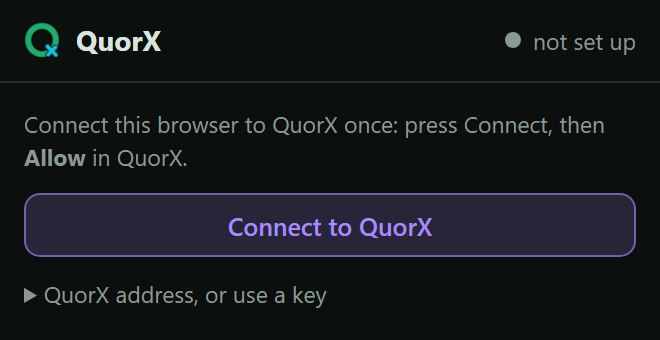
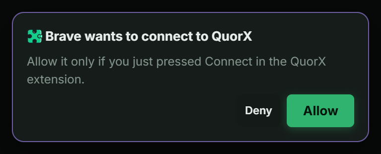
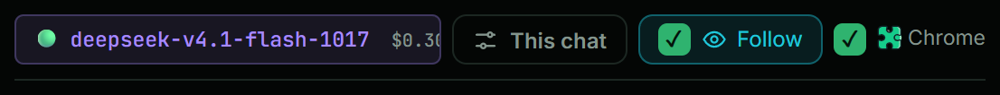
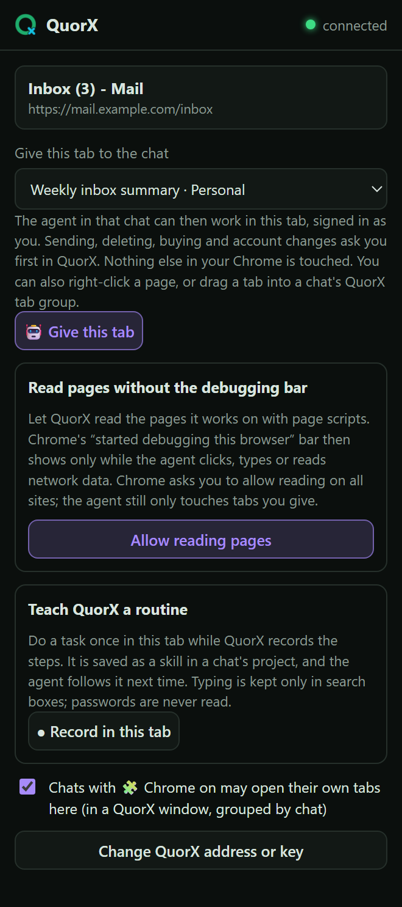
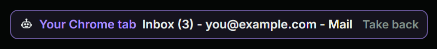
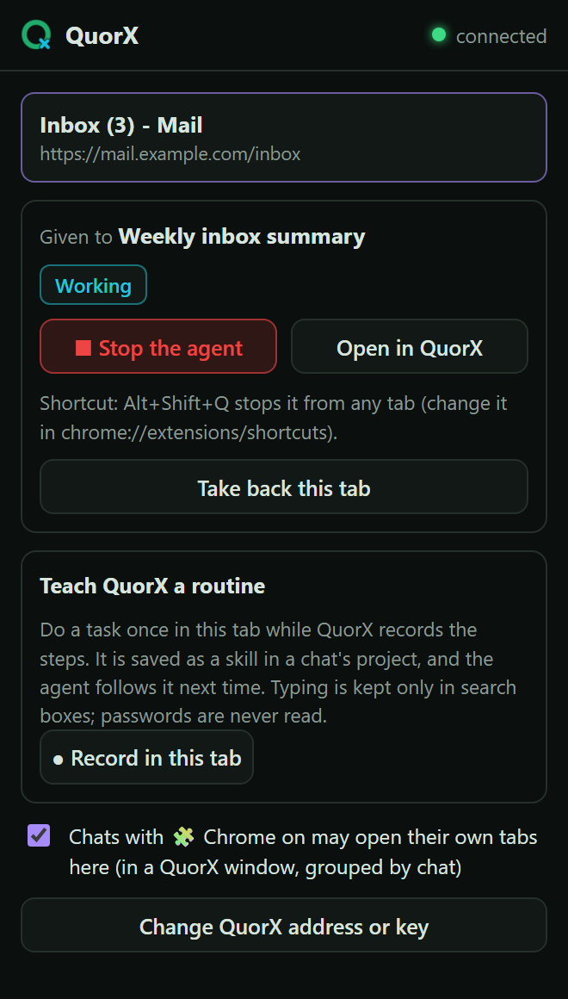
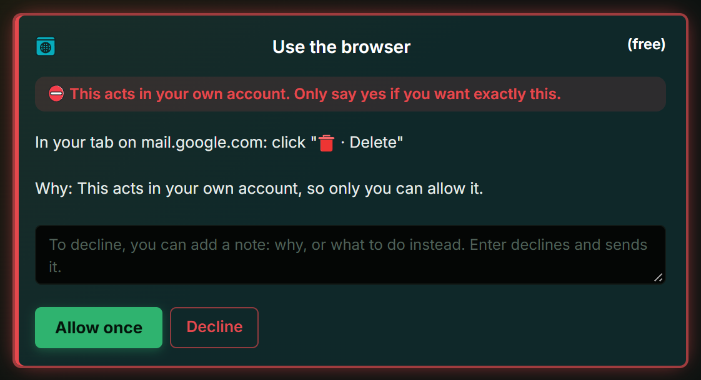

QuorX's agent has always had a browser of its own. It opens what it builds, scrolls, clicks and checks the screenshots.
That browser is built into the app, and for the agent's own pages it is exactly right.

It is the wrong place for *your* accounts. Google, X and a growing list of other sites refuse to sign in inside an
app's built-in browser. You get a page that says "This browser or app may not be secure", and no amount of trying
again changes it. Passkeys don't show their prompt there either.

From 0.2.11 the agent can work in **your everyday browser** instead: Chrome, Brave or Edge, where you are already
signed in. Nothing to sign in again, no new profile, and nothing for Google to block, because it is simply your
browser.

```compare
{ "prompt": "Check x.com and tell me what the latest post says", "options": [
  { "label": "The built-in browser", "steps": [
    { "title": "The agent opens x.com", "text": "in QuorX's own browser, which has never signed in anywhere" },
    { "title": "X shows its login wall", "text": "and Google sign-in says the browser may not be secure", "bad": true },
    { "title": "The agent asks you to paste the post", "text": "or to send a screenshot", "bad": true }
  ], "verdict": { "title": "Stuck at the door", "text": "Sites that block built-in browsers stay out of reach, however good the model is." } },
  { "label": "Your own browser", "steps": [
    { "title": "The agent opens x.com in your browser", "text": "in a QuorX window, signed in as you" },
    { "title": "It reads the timeline", "text": "like you would, with the same session you already have" },
    { "title": "It answers in the chat", "text": "and stops to ask before it posts, replies or deletes anything" }
  ], "verdict": { "title": "Straight in, with you in charge", "text": "The agent sees what you see, and every action that changes something waits for your yes." } }
] }
```

## What's new in 0.2.12

The extension is now version 0.3, and the agent is steadier in your browser:

- **Stop it from anywhere.** The extension's popup has **■ Stop the agent**, and **Alt+Shift+Q** stops it from any
  tab. Stop in QuorX now ends a browser step at once, too.
- **See what it's doing.** The QuorX button in your toolbar shows whether the agent is working, waiting for you, or
  done, and the tab it works in gets a thin border.
- **Read without the debugging bar.** Once you allow it, the agent reads pages without Chrome's "started debugging this
  browser" bar. The bar shows up only while it clicks or types.
- **Tidy tabs.** The agent's tabs sit in a "QuorX · chat" tab group in their own window, at most 6 per reply, and they
  close when the reply ends.
- **More ways to give a tab.** Right-click a page, a selection, a link or a picture, or drag a tab into a chat's group.
- **Site rules.** List sites the agent may never open, sites it may always open, and sites where it only reads.
- **Teach it a routine.** Do a task once while QuorX records it, and the agent follows the same steps next time.
- **Steadier pages.** Every click waits for the page to settle, and the agent checks a button is visible and not
  covered before it clicks. It can also scroll long chat lists and gather a whole feed while it scrolls.

## What it unlocks

Anything you can do signed in, the agent can now read and help with:

- **Your inbox**: summarise today's mail, find the invoice from last week, draft a reply for you to send.
- **Social feeds**: see what people say about your project on X, collect the posts that mention a bug.
- **Dashboards you pay for**: read numbers from analytics, hosting or billing pages that have no public API.
- **Long forms**: fill in the boring parts of a form for you to check, then stop before Submit.
- **Research behind a login**: papers, docs or courses in tools you already have accounts for.
- **Chores you repeat**: record the clicks once, then ask for it by name.

The agent still builds and checks its own pages in its own browser. Your browser is only for the work that needs you.

## How a request travels

```flow
{ "nodes": [
  { "id": "chat", "title": "You ask in a chat", "sub": "🧩 Chrome ticked", "cap": "You tick 🧩 Chrome for this chat and ask, for example, to check your latest emails." },
  { "id": "agent", "title": "The agent opens a tab", "sub": "chrome:mail.google.com", "cap": "The agent asks QuorX for a tab at that address in your browser. A site you put under Never open is refused, and one your request didn't name asks you first." },
  { "id": "ext", "title": "The QuorX extension", "sub": "in your browser", "cap": "The extension opens it in the chat's tab group, in a separate QuorX window, and works only in that chat's tabs." },
  { "id": "page", "title": "Your signed-in page", "sub": "your own session", "cap": "The page is yours: same sign-ins, same cookies. Each step waits for the page to settle, and the toolbar button shows the agent is working." },
  { "id": "ask", "title": "A red card for big steps", "sub": "send · delete · buy", "cap": "Before a click that sends, deletes, buys, posts or changes your account, QuorX asks you. Always, in every mode. If QuorX is in the background, Windows shows a notification that opens the chat." },
  { "id": "answer", "title": "The answer in your chat", "sub": "tabs close", "new": true, "cap": "What it read and did comes back to the chat, step by step. When the reply ends, the tabs it opened close; tabs you gave stay." }
], "loops": [{ "from": "page", "to": "agent", "label": "next step" }] }
```

## Set it up once

The extension ships inside QuorX. Setting it up takes about a minute, and you do it once.



1. In QuorX, open **⚙ Settings → Code & servers → Chrome extension**. It names your default browser (Brave,
   Chrome or Edge) and has an **Open** button for its extensions page.
2. Turn on **Developer mode** on that page, press **Load unpacked**, and pick the folder QuorX shows. **Copy path** and
   **Show folder** are right next to it.
3. Click the QuorX icon in your browser's toolbar and press **Connect to QuorX**.
4. QuorX asks whether to allow it. Press **Allow**.
5. Optional: in the same popup, press **Allow reading pages**. Your browser asks to let QuorX read sites. This only
   changes how the agent reads the tabs you give it, and it never touches other tabs. In return, the debugging bar
   shows only while the agent clicks or types.





No key to copy: the Allow click is the pairing. The extension updates itself after that: when QuorX has a newer
version, it reloads itself. If you set it up on 0.2.11, it moves to 0.3 by itself.

```callout
{ "tone": "info", "title": "Why Load unpacked?", "text": "Browsers only install extensions from their store or from a folder you pick yourself. Until QuorX is in the Chrome Web Store, picking the folder is the one step no app can do for you." }
```

## Ways to use it

**Tick 🧩 Chrome in a chat.** It sits under the message box, next to Follow. With it on, the agent in that chat can
open its own tabs in your browser, in a separate QuorX window, whenever the request needs your accounts. Each chat's
tabs are grouped as "QuorX · chat name". Other chats can't use them. Untick it and that chat's agent can't touch your
browser at all.



**Give one tab.** Already on the page you mean? Click the QuorX icon on that tab, pick the chat, and press
**🤖 Give this tab**. Or right-click the page and give it from the menu. If you right-click selected text, the
selection goes to the agent with the tab. You can also drag a tab into a chat's QuorX group. The chat shows which tab
it has, with **Take back** next to it.





**Let a schedule use it.** A scheduled chat with 🧩 Chrome on can check your dashboards or inbox while you're away.
The same red cards apply, so anything that changes something waits for you.

## While it works

The popup for a given tab shows the chat, what the agent is doing, **■ Stop the agent** and **Open in QuorX**.
**Alt+Shift+Q** stops every reply that is using your browser, from any tab. You can change the shortcut on your
browser's extension shortcuts page.



The agent's window opens at 1400×900. If you shrink or minimise it, it goes back to that size, so the agent always
sees a full page. A chat opens at most 6 tabs of its own per reply. After that it reuses the current one.

When a reply ends, the tabs the agent opened close, so an empty QuorX window means it has finished. To keep them, turn
off **Close the agent's tabs when it's done** in Settings.

## Teach it a routine

Some chores are the same clicks every week. In the popup, press **● Record in this tab** and do the task once. Then
name it, pick a chat whose project should keep it, and press **Stop and save**. QuorX saves the steps as a skill in
that project, and the agent follows them the next time you ask.

Recording keeps what you type only in search boxes, and it never reads passwords.

## Site rules

In **⚙ Settings → Code & servers → Chrome extension** you decide where the agent may go:

- **Never open**: sites it may never open in your browser, such as your bank. A site includes its subdomains.
- **Always allowed**: sites it may open without asking, even when your request didn't name them.
- **Read-only sites**: typing outside a search box always asks you on these, whatever the request says.

Two more switches sit next to them. **Read-only for reading requests** is on by default: when you ask the agent to
read, check or summarise, typing into your account asks you first. **Deciders check typing in your tabs** has the
deciders judge, from your request alone, whether each thing the agent types serves what you asked.

## What it can't do

The extension sits next to all your accounts, so it is built to do as little as possible:

```matrix
{ "levels": [{ "id": "proven", "label": "By design" }, { "id": "tested", "label": "Your switch" }],
  "columns": ["Protection", "How"],
  "rows": [
    { "level": "proven", "cells": ["Only tabs you allowed", "The extension refuses any command for a tab that wasn't given or opened for that chat."] },
    { "level": "proven", "cells": ["Asks before it acts", "Send, delete, buy, pay, post, reply, sign out, settings and passwords get a red card. The deciders never answer it, even in ⚡ YOLO."] },
    { "level": "proven", "cells": ["Asks before a new site", "A site your request didn't name asks you before it opens, unless you listed it under Always allowed."] },
    { "level": "proven", "cells": ["Only QuorX can connect", "The link only accepts a browser extension, paired by your Allow click. A web page can't use it."] },
    { "level": "proven", "cells": ["You see when it works", "The toolbar button shows its status and the tab gets a border. Chrome's debugging bar shows while it clicks or types."] },
    { "level": "proven", "cells": ["Network data without secrets", "When the agent reads a page's data requests, cookies, tokens and passwords are removed, and nothing is sent again."] },
    { "level": "tested", "cells": ["Stop it any time", "■ Stop in the popup, Alt+Shift+Q, Stop in QuorX, Take back, or close the tab."] },
    { "level": "tested", "cells": ["Keep sites off limits", "Never open and Read-only sites in Settings."] },
    { "level": "tested", "cells": ["Turn it off", "Untick 🧩 Chrome in a chat, or switch off new tabs in the extension's popup."] }
  ] }
```



```callout
{ "tone": "warn", "title": "Pages can talk back", "text": "A web page or an email can contain text written to steer an AI agent. That is why every action that changes something waits for your yes, and why QuorX tells the agent that page text is information, never instructions. Give it the tabs a task needs, keep sensitive sites under Never open, and read a red card before you allow it." }
```

## What's next

A listing in the Chrome Web Store, so installing becomes one click. Until then, the folder in QuorX is the
extension, and it keeps itself up to date.
